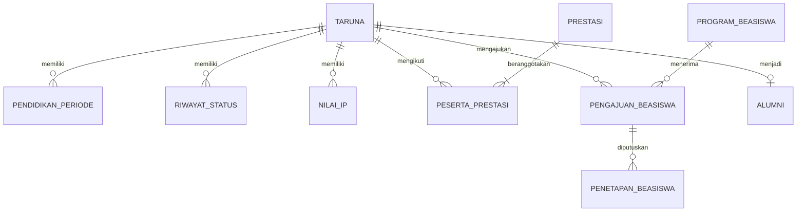
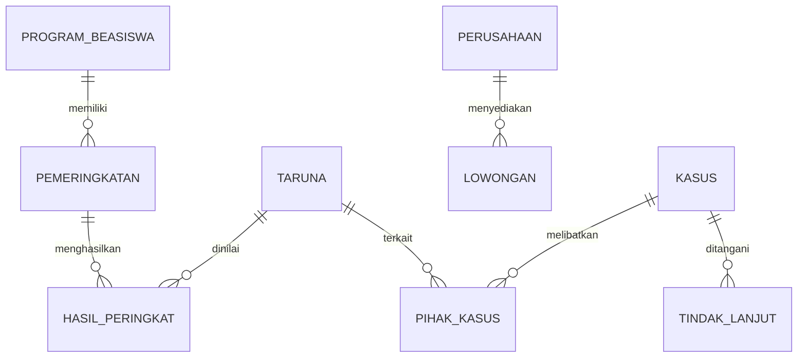

# Product Requirements Document ECC 2.0

| Atribut | Nilai |
| --- | --- |
| Produk | Evidence Command Center 2.0 |
| Institusi | Politeknik Keselamatan Transportasi Jalan Tegal |
| Proyek | Project PKA Aji |
| Versi dokumen | 0.1 |
| Tanggal | 4 November 2026 |
| Status | Draf baseline produk untuk pembahasan dan implementasi |
| Pemilik proses | Unit Ketarunaan dan Alumni, mengikuti penetapan PKTJ |
| Pengusul proyek | Aji Ronaldo |

## 1 Tujuan dokumen dan dasar penyusunan

PRD ini mengonsolidasikan riwayat pembahasan fitur, revisi struktur data, rancangan mock-up, dan draf SOP ECC 2.0. Dokumen menjadi acuan pengembangan dan pengujian MVP, bukan pernyataan bahwa aplikasi sudah selesai dibangun atau bahwa seluruh aturan telah disahkan.

Urutan acuan ketika terjadi perbedaan adalah keputusan eksplisit terbaru dalam pembahasan, konsolidasi kebutuhan pada PRD ini, lalu mock-up sebagai referensi visual. Draf SOP menjelaskan cara kerja operasional dan tetap memerlukan pengesahan. Perubahan baseline berikutnya dicatat dalam log keputusan.

Label kebutuhan:

- **Baseline:** keputusan produk yang sudah dibahas dan menjadi lingkup MVP.
- **Usulan implementasi:** rincian untuk membuat baseline dapat dibangun dan diuji; perlu ditinjau tim teknis atau pemilik proses.
- **Terbuka:** kebijakan atau parameter yang belum diputuskan; aplikasi tidak boleh mengarang nilainya.
- **Lanjutan:** kebutuhan di luar rilis MVP ini.

Sumber utama: riwayat pengembangan dalam percakapan proyek; mock-up Dashboard, Database Taruna, Rekam Jejak, Prestasi, Pelanggaran, Beasiswa revisi empat jenis, dan Lowongan Pekerjaan; serta [Draf SOP Penggunaan ECC 2.0](https://chatgpt.com/library?file_id=libfile_5e6f6a9276048191876265933ca4f366&account_id=personal), versi draf 0.1 tanggal 4 November 2026. PRD tidak mengklaim telah memverifikasi regulasi atau keputusan internal PKTJ.

## 2 Masalah dan hasil yang dituju

Data ketarunaan dan alumni tersebar pada unit dan berkas yang berbeda. Permintaan informasi memerlukan pengumpulan, penyandingan, dan pemeriksaan manual. Riwayat status, bukti, serta dasar perhitungan laporan sulit ditelusuri secara konsisten.

ECC 2.0 menyediakan satu pengelolaan data yang terhubung melalui Nomor Taruna, dilengkapi bukti dan validasi unit, kemudian menyajikan dashboard serta laporan untuk pengambilan keputusan berbasis bukti.

Hasil yang dituju:

1. Satu identitas taruna dipakai lintas modul, termasuk setelah berhenti atau lulus.
2. Perubahan status dan riwayat kegiatan dapat ditelusuri berdasarkan tanggal serta bukti.
3. Angka dashboard memiliki definisi, filter, dan sumber yang dapat diperiksa.
4. Seleksi beasiswa mengikuti mekanisme tiap jenis dan menyimpan dasar penetapan.
5. Informasi lowongan diperiksa sebelum diterbitkan dan dikendalikan masa tayangnya.

## 3 Evolusi keputusan produk

| Tahap pembahasan | Keputusan yang dipakai saat ini | Dampak |
| --- | --- | --- |
| Gagasan awal PINTAR dan pengembangan ECC | Pengembangan ECC yang sudah ada dengan fokus MVP Ketarunaan dan Alumni | Tidak seluruh gagasan awal masuk rilis pertama |
| Identitas taruna | Hapus isian ID Taruna; NIM diganti Nomor Taruna yang unik | Gunakan identitas bisnis yang konsisten |
| Database Taruna Aktif | Menjadi Database Taruna dengan seluruh status | Taruna yang cuti, skorsing, berhenti, dan lulus tetap tercatat |
| Pemisahan lulusan | Alumni dibentuk dari Lulus tervalidasi | Mengundurkan Diri dan Drop Out bukan lulusan |
| Lingkup akademik | CPL/CPMK dikeluarkan dari MVP | IP semester tetap diperlukan untuk beasiswa Apresiasi |
| Prestasi tim | Satu peristiwa dengan banyak peserta | Jumlah prestasi dibedakan dari jumlah peserta unik |
| Pelanggaran | Pisahkan dugaan, hasil penetapan, penyelesaian, dan validasi | Dugaan tidak otomatis menjadi pelanggaran terbukti |
| Revisi Beasiswa | Empat jenis dengan mekanisme berbeda | Pemeringkatan Apresiasi dan tiga formulir klaim |
| Lowongan Pekerjaan | Informasi karier terverifikasi dengan kanal lamaran eksternal | Validasi, publikasi, dan tenggat dikendalikan terpisah |

## 4 Lingkup rilis

### 4.1 Baseline MVP

| Modul | Cakupan |
| --- | --- |
| Dashboard | Ringkasan lintas modul, enam status pendidikan, filter, penelusuran sumber, ekspor |
| Database Taruna | Identitas, pendidikan, kontak dan keluarga, riwayat pendidikan, perubahan dan riwayat status, impor |
| Rekam Jejak Taruna | Ringkasan individu, kronologi, capaian atau kegiatan, tautan sumber, bukti |
| Prestasi | Akademik dan nonakademik, individu atau tim, peserta, bukti, validasi |
| Pelanggaran | Laporan awal, pemeriksaan, penetapan, sanksi atau tindak lanjut, bukti, riwayat |
| Beasiswa | Program, Apresiasi, Prestasi, Daerah 3TP, Tidak Mampu, verifikasi, penetapan, penerima |
| Lowongan Pekerjaan | Daftar dan detail, perusahaan, kontak, dokumen, verifikasi, publikasi, penutupan, riwayat |
| Alumni | Profil dasar dari kelulusan tervalidasi dan pembaruan kontak |
| Tata Kelola | Validasi Data, Laporan, Pengaturan, hak akses, referensi, jejak aktivitas |

### 4.2 Pengembangan lanjutan

Kesehatan dan psikologi terperinci; tracer study dan survei pengguna lulusan lengkap; umpan balik kurikulum; CPL/CPMK dan nilai per mata kuliah; penilaian akademik, semapta, dan softskill yang belum dirinci dalam MVP; rekomendasi kerja otomatis; pelacakan lamaran dan hasil penempatan; pencairan serta akuntansi beasiswa.

Keberadaan istilah tersebut dalam gagasan atau navigasi awal tidak berarti sudah menjadi kebutuhan operasional rilis ini. Integrasi dengan sistem akademik dan ECC 1.0 memerlukan pemetaan teknis tersendiri.

## 5 Pengguna dan kewenangan

| Peran | Kebutuhan utama | Batas akses |
| --- | --- | --- |
| Pimpinan atau pembaca | Melihat ringkasan, menelusuri sumber, mengekspor laporan | Sesuai lingkup organisasi; bukti sensitif tidak terbuka secara otomatis |
| PIC atau operator unit | Input, impor, bukti, pengajuan, koreksi | Modul dan lingkup data yang ditugaskan |
| Validator unit | Pemeriksaan, pengembalian, validasi | Sesuai kewenangan substantif |
| Pengelola beasiswa | Program, pemeringkatan, klaim, pencatatan keputusan | Dokumen ekonomi dan klaim sesuai tugas |
| Pengelola alumni dan karier | Profil dasar, perusahaan, lowongan, publikasi | Kontak dan dokumen yang relevan |
| Admin sistem | Akun, peran, referensi, konfigurasi, dukungan | Hak teknis tidak otomatis memberikan kewenangan pengesahan substansi |
| Taruna atau alumni | Pengajuan atau pembaruan milik sendiri | Akun layanan mandiri bersifat opsional untuk MVP |

Baseline layanan harus tetap berjalan melalui input PIC jika akun taruna atau alumni belum dibangun. Identitas pemohon dan petugas pencatat harus dibedakan. Pembagian jabatan, unit, dan pengecualian perangkapan pencatat-validator ditetapkan PKTJ.

## 6 Arsitektur informasi dan tampilan

### 6.1 Navigasi utama

- Dashboard: Ringkasan.
- Data Ketarunaan: Database Taruna, Rekam Jejak Taruna, Prestasi, Pelanggaran, Beasiswa.
- Karier dan Alumni: Lowongan Pekerjaan, Alumni dengan label profil dasar.
- Tata Kelola: Validasi Data, Laporan, Pengaturan.
- Akses Modul ECC 1.0 mengikuti ketersediaan dan integrasi yang disepakati.

### 6.2 Konsistensi visual

Baseline desain: latar dominan putih dan biru sangat muda; aksen biru Argentina; teks navy; emas secukupnya; sidebar putih; kartu dan tabel yang rapi. Gunakan logo PKTJ yang disetujui, bukan lambang yang dibuat ulang secara bebas. Header, navigasi, breadcrumb, filter, tombol, label status, dan formulir harus konsisten antarmodul.

Mock-up desktop menggunakan rasio 16:9 sebagai referensi presentasi. Responsivitas layar lebih kecil merupakan usulan implementasi. Nama Aji Ronaldo, tanggal, jumlah, identitas, perusahaan, dan lowongan pada mock-up merupakan contoh, bukan nilai tetap aplikasi. Penanda data simulasi harus jelas pada lingkungan demo.

### 6.3 Inventaris halaman

| Modul | Halaman atau sub-menu |
| --- | --- |
| Database Taruna | Daftar, Identitas Utama, Data Pendidikan, Kontak dan Keluarga, Riwayat Pendidikan, Riwayat Status, Ubah Status, Impor |
| Rekam Jejak | Pencarian, Ringkasan, Kronologi, Daftar Capaian, Tambah Capaian, Detail dan Bukti, Dokumen |
| Prestasi | Daftar, Tambah atau Ubah, Peserta, Detail, Dokumen, Riwayat Validasi |
| Pelanggaran | Daftar, Laporan Awal, Pemeriksaan, Penetapan dan Tindak Lanjut, Detail, Dokumen, Riwayat Validasi |
| Beasiswa | Ringkasan, Program, Seleksi Apresiasi, Klaim Prestasi, Klaim 3TP, Klaim Tidak Mampu, Verifikasi, Penerima dan Penetapan |
| Lowongan | Daftar, Tambah atau Ubah, Detail, Perusahaan dan Kontak, Dokumen dan Sumber, Verifikasi dan Publikasi, Riwayat |
| Tata Kelola | Antrean Validasi, Detail Pemeriksaan, Laporan dan Ekspor, Pengguna dan Peran, Referensi |

## 7 Persyaratan fungsional

Semua kebutuhan di bagian ini adalah baseline perilaku produk. Rincian skema, target teknis, serta kebijakan yang belum ditentukan diberi label pada bagian terkait.

### 7.1 Tata kelola bersama

| ID | Persyaratan | Kriteria penerimaan |
| --- | --- | --- |
| GOV-01 | Autentikasi dan hak akses berdasarkan peran serta lingkup | Akses langsung ke rekaman atau dokumen di luar kewenangan ditolak, termasuk melalui URL atau ekspor |
| GOV-02 | Siklus draf, pengajuan, pemeriksaan, koreksi, validasi | Pengembalian wajib memuat alasan; pengajuan ulang mempertahankan riwayat |
| GOV-03 | Revisi substansial data tervalidasi diperiksa ulang | Draf revisi tidak diam-diam mengganti versi sah pada rekap |
| GOV-04 | Sumber, bukti, dan jejak perubahan | Petugas, waktu, tindakan, objek, dan alasan perubahan dapat ditelusuri |
| GOV-05 | Referensi terkelola | Referensi yang digunakan data lama tidak hilang karena dinonaktifkan |
| GOV-06 | Ekspor mengikuti hak akses dan filter | Isi ekspor sesuai hasil filter dan menyertakan konteks periode serta tanggal ekspor |
| GOV-07 | Pencegahan duplikasi dan penanganan kesalahan | Kesalahan tampil pada isian atau baris terkait; data tidak tersimpan sebagian tanpa penjelasan |

Label teknis status validasi yang diusulkan: `DRAF`, `DIAJUKAN`, `PERLU_PERBAIKAN`, `TERVALIDASI`, dan `DIBATALKAN`. Label dapat disesuaikan, tetapi pemisahan maknanya harus dipertahankan. Keputusan formal, hasil verifikasi, publikasi, dan status pendidikan tidak digabung menjadi satu kolom status.

### 7.2 Database Taruna

| ID | Persyaratan | Kriteria penerimaan |
| --- | --- | --- |
| TAR-01 | Nomor Taruna unik berbentuk teks | Duplikasi ditolak; nol di awal tidak hilang; antarmuka tidak meminta NIM atau ID Taruna tambahan |
| TAR-02 | Kelola identitas, pendidikan, kontak, dan keluarga | Isian sesuai kamus data, dengan validasi dan perlindungan data pribadi |
| TAR-03 | Daftar seluruh status pendidikan | Filter menampilkan Aktif, Skorsing, Cuti Akademik, Mengundurkan Diri, Drop Out, dan Lulus |
| TAR-04 | Riwayat status dengan tanggal efektif dan bukti | Status pada tanggal acuan dapat direkonstruksi; perubahan tidak menghapus master |
| TAR-05 | Cuti dan skorsing memiliki rencana akhir jika tersedia | Lewat rencana akhir tidak otomatis mengubah menjadi Aktif |
| TAR-06 | Riwayat pendidikan per periode | Kelas pada periode penilaian dapat ditelusuri untuk seleksi Apresiasi |
| TAR-07 | Impor bertemplat dan pratinjau | Baris salah, duplikasi, hasil berhasil atau ditolak tercatat; impor tidak otomatis memvalidasi |
| TAR-08 | Koreksi identitas terkendali | Koreksi Nomor Taruna oleh petugas khusus menjaga seluruh relasi dan jejak lama; prosedurnya perlu disepakati |

Alur: cari identitas → tambah atau ubah → lengkapi bukti → ajukan → validasi. Perubahan status: pilih status tujuan → masukkan tanggal berlaku, alasan, dan keputusan → validasi → perbarui status efektif serta riwayat.

### 7.3 Rekam Jejak Taruna

| ID | Persyaratan | Kriteria penerimaan |
| --- | --- | --- |
| RJK-01 | Ringkasan dan kronologi per Nomor Taruna | Pengguna dapat memfilter periode serta jenis dan membuka sumber sesuai hak akses |
| RJK-02 | Catat kegiatan atau capaian tambahan | Judul, kategori, waktu, penyelenggara, uraian, dan bukti tersedia |
| RJK-03 | Hubungkan rekaman modul sumber | Prestasi, beasiswa, status, dan kasus tidak disalin sebagai kejadian ganda |
| RJK-04 | Lindungi informasi kasus | Dugaan tidak ditampilkan sebagai pelanggaran terbukti; bukti sensitif tidak terbuka bagi pembaca umum |

### 7.4 Prestasi

| ID | Persyaratan | Kriteria penerimaan |
| --- | --- | --- |
| PRE-01 | Akademik atau nonakademik, tingkat, hasil, tanggal, penyelenggara | Informasi sesuai bukti dan dapat dicari atau difilter |
| PRE-02 | Peserta individu atau tim | Satu prestasi tim memiliki banyak peserta; peserta sama tidak didaftarkan dua kali pada peristiwa yang sama |
| PRE-03 | Sertifikat dan dokumentasi tertaut | Validator dapat mencocokkan peserta, tanggal, dan hasil |
| PRE-04 | Rekap dua satuan | Satu prestasi tim dengan lima anggota menghasilkan satu prestasi dan lima peserta unik |
| PRE-05 | Tautan untuk klaim beasiswa | Validasi prestasi tidak otomatis menetapkan penerima beasiswa |

### 7.5 Pelanggaran

| ID | Persyaratan | Kriteria penerimaan |
| --- | --- | --- |
| PEL-01 | Catat laporan dugaan dan pihak terkait | Laporan baru belum dihitung sebagai kasus terbukti |
| PEL-02 | Kelola pemeriksaan dan bukti | Klarifikasi, berita acara, dan sumber tersedia bagi petugas berwenang |
| PEL-03 | Hasil penetapan terpisah | Nilai: Dugaan, Terbukti, Tidak terbukti, Dibatalkan |
| PEL-04 | Penyelesaian terpisah | Nilai: Proses, Selesai, Banding; setiap perubahan memiliki waktu dan bukti |
| PEL-05 | Sanksi atau tindak lanjut berdasarkan keputusan | Dasar, tanggal, PIC, dan target tersedia; perubahan status pendidikan melalui TAR-04 |
| PEL-06 | Rekap dan kerahasiaan | Hanya Terbukti dan tervalidasi masuk rekap pelanggaran terbukti; identitas serta bukti dibatasi |

Banding tidak otomatis membatalkan keputusan. Perubahan hasil hanya mengikuti keputusan baru yang sah dan mempertahankan riwayat sebelumnya.

### 7.6 Beasiswa

Empat jenis baseline adalah **Apresiasi, Prestasi akademik atau nonakademik, Daerah 3TP, dan Tidak Mampu**. Pemerintah, mitra, atau internal merupakan sumber dana atau pemberi, bukan pengganti jenis tersebut.

| ID | Persyaratan | Kriteria penerimaan |
| --- | --- | --- |
| BEA-01 | Kelola program per jenis dan periode | Nama, sumber dana, nominal bila ditetapkan, jadwal, persyaratan, dan penanggung jawab tersedia |
| BEA-02 | Apresiasi memakai lima IP tertinggi di setiap kelas | IP semester, bukan IPK; kelas dan populasi pada periode penilaian dapat ditelusuri |
| BEA-03 | Simpan versi pemeringkatan | Parameter, sumber nilai, hasil, waktu, petugas, dan catatan pengecualian tersimpan |
| BEA-04 | Tangani seri peringkat kelima | Jika aturan belum ditetapkan, finalisasi kelas terkait ditahan; sistem tidak memilih secara acak |
| BEA-05 | Klaim Prestasi | Prestasi selama menjadi taruna, keanggotaan peserta, sertifikat, dan dokumentasi dapat diperiksa |
| BEA-06 | Klaim Daerah 3TP | Domisili, kode wilayah, tanggal acuan, bukti, dan versi acuan wilayah diperiksa |
| BEA-07 | Klaim Tidak Mampu | Kondisi ekonomi dan dokumen menurut ketentuan program tersedia; akses dibatasi |
| BEA-08 | Input PIC dapat mewakili pemohon | Identitas taruna, sumber klaim, tanggal diterima, dan pencatat tersimpan |
| BEA-09 | Verifikasi dan penetapan terpisah | Memenuhi persyaratan belum menjadi penerima; kandidat belum menjadi penerima |
| BEA-10 | Penetapan memiliki keputusan | Nomor, tanggal, pejabat, dokumen, dan validasi penetapan tersedia |
| BEA-11 | Rekap penerima resmi | Hanya penetapan tervalidasi dihitung; jumlah penetapan dibedakan dari penerima unik |

Alur Apresiasi: program → nilai dan kelas tervalidasi → hitung peringkat → lima kandidat per kelas → pemeriksaan → keputusan → validasi penetapan → rekap.

Alur tiga klaim: program → formulir sesuai jenis → unggah atau tautkan bukti → ajukan → pemeriksaan atau perbaikan → hasil verifikasi → keputusan → validasi penetapan → rekap.

Kebijakan kelayakan status pendidikan, periode nilai, pembulatan, seri, kelas kurang dari lima peserta, penerimaan ganda, kuota tiga klaim, acuan 3TP, serta daftar dokumen ekonomi masih terbuka. Tanggal skorsing atau cuti tidak otomatis menyimpulkan kelayakan tanpa aturan program.

### 7.7 Lowongan Pekerjaan

| ID | Persyaratan | Kriteria penerimaan |
| --- | --- | --- |
| LOW-01 | Master perusahaan dan kontak | Nama, sektor, alamat, website, PIC, kontak, sumber dan waktu pemeriksaan tersimpan |
| LOW-02 | Input lowongan lengkap | Posisi, perusahaan, lokasi, jenis kerja, pendidikan atau prodi, persyaratan, tenggat, kanal lamaran, sumber tersedia |
| LOW-03 | Dokumen dan konfirmasi sumber | Surat, poster, atau bukti konfirmasi tertaut; bukti internal dibatasi |
| LOW-04 | Verifikasi per lowongan | Kontak perusahaan terverifikasi tidak otomatis memvalidasi seluruh lowongannya |
| LOW-05 | Publikasi sesudah validasi | Draf tidak tampil pada daftar terbuka; hanya lowongan tervalidasi, terbit, dan dalam masa lamaran yang tampil |
| LOW-06 | Penutupan dan tenggat | Lewat tenggat atau ditarik tidak tampil sebagai terbuka; arsip dan alasan tetap ada |
| LOW-07 | Riwayat dan perubahan | Perubahan substansial sesudah terbit memerlukan pemeriksaan ulang |
| LOW-08 | Kanal lamaran eksternal | Tombol membuka kanal perusahaan; klik tidak dihitung sebagai pelamar atau diterima bekerja |

Status publikasi yang diusulkan: Draf, Terbit, Ditutup. Waktu kedaluwarsa ditentukan dari tenggat; zona waktu dan batas jam harus disepakati. Dashboard memeriksa tenggat saat membaca data sehingga tidak bergantung hanya pada tugas penutupan terjadwal.

### 7.8 Alumni

| ID | Persyaratan | Kriteria penerimaan |
| --- | --- | --- |
| ALM-01 | Profil dari kelulusan tervalidasi | Lulus membentuk profil dasar terkait identitas lama; Mengundurkan Diri dan Drop Out tidak membentuk profil lulusan |
| ALM-02 | Pembaruan kontak terlacak | Sumber konfirmasi, pencatat, dan waktu tersimpan |
| ALM-03 | Koreksi kelulusan terkendali | Dampak pada profil alumni dan laporan ditinjau tanpa menghilangkan jejak |

## 8 Dashboard dan definisi indikator

| Indikator | Definisi dan satuan |
| --- | --- |
| Status pendidikan | Taruna unik berdasarkan status tervalidasi yang berlaku pada tanggal acuan |
| Dalam pendidikan | Aktif + Skorsing + Cuti Akademik |
| Berhenti pendidikan | Mengundurkan Diri + Drop Out |
| Lulusan | Lulus tervalidasi, disajikan terpisah |
| Seluruh rekaman taruna | Master unik dalam lingkup filter; data tanpa status tervalidasi diberi kategori kualitas data tersendiri |
| Prestasi | Peristiwa prestasi tervalidasi pada periode kejadian |
| Taruna berprestasi | Nomor Taruna unik peserta prestasi dalam periode dan filter |
| Pelanggaran terbukti | Kasus Terbukti dan tervalidasi; satuan kasus, bukan jumlah pihak terkait |
| Beasiswa | Penetapan penerima tervalidasi, dikelompokkan empat jenis dan periode |
| Penerima beasiswa unik | Nomor Taruna unik dalam penetapan yang memenuhi filter |
| Lowongan terbuka | Lowongan tervalidasi, terbit, belum ditutup, dan belum melewati tenggat |
| Antrean validasi | Pengajuan menunggu pemeriksaan; tidak digabung dengan hasil tervalidasi |

**DSH-01:** filter periode, tanggal acuan, prodi, angkatan, dan status mengikuti karakter modul. Filter yang tidak berlaku harus dijelaskan atau dinonaktifkan.

**DSH-02:** kartu ringkasan dapat ditelusuri ke daftar dengan filter yang sama, sesuai kewenangan pengguna.

**DSH-03:** hasil ekspor menyertakan definisi satuan, tanggal acuan, waktu ekspor, dan filter; angka simulasi tidak dipakai sebagai baseline aktual.

**DSH-04:** riwayat status mendukung laporan as-of tanggal. Snapshot historis lintas semua modul belum diputuskan; laporan harus membedakan tanggal kejadian, tanggal efektif, dan waktu pembaruan. Koreksi retrospektif tidak boleh disamarkan sebagai data yang sudah diketahui sejak awal.

## 9 Model data konseptual

Nama entitas berikut adalah usulan implementasi; tidak menetapkan teknologi basis data tertentu. Nomor Taruna tetap satu-satunya identitas bisnis taruna yang diinput pengguna. Kunci teknis objek lain dapat dipakai tanpa menambah isian ID Taruna pada antarmuka.

| Entitas | Grain atau satu rekaman | Atribut utama |
| --- | --- | --- |
| Taruna | Satu orang | nomor_taruna unik teks, nama, nik terlindungi, jenis kelamin, tempat dan tanggal lahir, agama opsional, foto opsional |
| Profil pendidikan | Profil pendidikan taruna | prodi, angkatan, tahun masuk, jalur penerimaan, asal formasi |
| Pendidikan periode | Satu taruna per periode | tingkat, kelas, semester aktif, referensi periode, validasi |
| Kontak keluarga | Kontak dan hubungan keluarga | nomor_taruna, telepon, email, alamat, nama wali, hubungan, kontak wali |
| Riwayat status | Satu kejadian perubahan status | status, berlaku_mulai, rencana_akhir opsional, alasan, keputusan, validasi |
| Nilai IP | Satu taruna per periode nilai | IP semester, sumber, versi, status validasi |
| Capaian | Satu kegiatan tambahan | kategori, judul, tanggal, uraian, penyelenggara, sumber |
| Prestasi | Satu peristiwa prestasi | kategori, tingkat, hasil, tanggal, penyelenggara, validasi |
| Peserta prestasi | Satu peserta pada satu prestasi | prestasi, nomor_taruna, peran atau tim bila diperlukan |
| Kasus pelanggaran | Satu laporan atau kasus | waktu, lokasi, uraian, penetapan, penyelesaian, validasi |
| Pihak kasus | Satu pihak dalam kasus | kasus, identitas atau referensi, peran, pembatasan akses |
| Pemeriksaan dan tindak lanjut | Satu tindakan dalam kasus | berita acara, keputusan, sanksi, PIC, tenggat, bukti |
| Program beasiswa | Satu program per periode | jenis, sumber dana, jadwal, nominal, aturan dan versi |
| Pemeringkatan | Satu versi seleksi per program dan kelas | periode nilai, populasi, parameter, versi, petugas |
| Hasil pemeringkatan | Satu peserta dalam versi seleksi | nomor_taruna, kelas, IP snapshot, peringkat, status kandidat |
| Pengajuan beasiswa | Satu kandidat atau klaim per program dan taruna | asal pengajuan, jenis, dasar, waktu, verifikasi |
| Detail klaim | Data sesuai jenis | prestasi terkait atau domisili dan acuan wilayah atau kondisi ekonomi |
| Penetapan beasiswa | Satu keputusan penerima | pengajuan, keputusan, tanggal, penetap, validasi, perubahan |
| Perusahaan | Satu pemberi lowongan | profil, kontak, sumber konfirmasi |
| Lowongan | Satu posisi atau pengumuman | perusahaan, persyaratan, sasaran, kanal, tenggat, validasi, publikasi |
| Alumni | Profil lulusan terkait master | nomor_taruna, kelulusan tervalidasi, kontak mutakhir |
| Dokumen dan tautan dokumen | Satu berkas dan relasinya | metadata, versi, sumber, pemilik, lingkup akses, objek terkait |
| Pengajuan validasi dan audit | Satu pemeriksaan atau tindakan | objek, versi, hasil, alasan, pelaku, waktu |
| Referensi | Satu nilai referensi berversi bila perlu | prodi, kelas, periode, kategori, wilayah, status aktif |

### 9.1 Relasi utama

Pihak eksternal kasus dapat dicatat tanpa memaksakan Nomor Taruna. Dokumen dan audit berelasi dengan objek modul masing-masing. Pemeringkatan menyimpan snapshot input untuk reproduksibilitas; kronologi mengambil sumber resmi, bukan menggandakan peristiwa.

### 9.2 Integritas data

- Relasi harus tetap utuh saat data berubah status, direvisi, dibatalkan, atau diarsipkan.
- Cegah status efektif yang tumpang tindih pada versi sah; koreksi retrospektif memerlukan alasan dan validasi.
- Cegah nilai IP ganda pada versi aktif untuk taruna dan periode yang sama.
- Cegah peserta prestasi duplikat dan pengajuan ganda program-taruna; aturan pengecualian perlu dikonfirmasi.
- Rentang IP mengikuti referensi akademik PKTJ yang dikonfirmasi; jangan mengunci skala tanpa keputusan sumber.
- Isian wajib, kondisional, dan opsional dibedakan. Kebutuhan dokumen beasiswa mengikuti program, bukan asumsi pengembang.
- Status terkini dapat diturunkan dari riwayat; data turunan tidak menjadi sumber baru yang saling bertentangan.

## 10 Persyaratan nonfungsional

| ID | Kebutuhan | Status dan cara verifikasi |
| --- | --- | --- |
| NFR-01 | Otorisasi di server pada daftar, detail, dokumen, dan ekspor | Baseline; uji akses lintas peran dan objek |
| NFR-02 | Perlindungan NIK, bukti kasus, kontak keluarga, dan ekonomi | Baseline; penyamaran pada tampilan agregat dan pembatasan dokumen |
| NFR-03 | Jejak audit serta versi keputusan | Baseline; uji perubahan sah dan koreksi |
| NFR-04 | Pencadangan dan pemulihan | Baseline kebutuhan; jadwal, retensi, RPO, dan RTO terbuka |
| NFR-05 | Pencarian, pagination, dan ekspor data | Baseline kemampuan; target latensi dan volume belum disepakati |
| NFR-06 | Validasi unggahan dan penyimpanan berkas terlindungi | Usulan implementasi; jenis, ukuran, pemindaian berkas, dan retensi perlu disepakati |
| NFR-07 | Tidak mengandalkan warna saja untuk status | Usulan implementasi; label teks dan navigasi keyboard diuji |
| NFR-08 | Transaksi aman dan pencegahan konflik edit | Usulan implementasi; pengguna diberi tahu bila versi berubah, tanpa menimpa diam-diam |
| NFR-09 | Pemisahan demo dan produksi | Baseline; data simulasi berlabel dan tidak masuk laporan resmi |
| NFR-10 | Penanganan gangguan dan rekonsiliasi | Selaras draf SOP; uji input tertunda, pemulihan, dan pencegahan duplikasi |

Tidak ada pilihan framework, layanan hosting, vendor, SSO, atau API produksi yang ditetapkan oleh riwayat mock-up. Pemilihan arsitektur mengikuti kajian tim TIK dan sistem ECC yang sudah ada.

## 11 Impor migrasi dan integrasi

1. Inventarisasi data sumber unit dan petakan kolom ke kamus data yang disepakati.
2. Bersihkan identitas unik, status, prodi, kelas, periode, serta dokumen sebelum impor.
3. Simpan pratinjau, daftar kesalahan per baris, hasil penerimaan, dan identitas petugas.
4. Pisahkan data impor yang belum diperiksa dari data yang sah pada dashboard.
5. Rekonsiliasi jumlah master, riwayat, dan relasi setelah migrasi; jangan menghapus data sumber sebelum hasil disetujui.
6. Integrasi sistem akademik untuk IP atau kelas bersifat opsi; impor terkendali dapat menjadi jalur MVP.
7. Kontrak integrasi ECC 1.0, metode autentikasi, API, dan kepemilikan sumber data masih terbuka.

## 12 Pengujian penerimaan pengguna

| ID | Skenario | Hasil yang harus terjadi |
| --- | --- | --- |
| UAT-01 | Input Nomor Taruna dengan nol awal dan duplikasi | Nol tetap utuh; duplikasi ditolak |
| UAT-02 | Aktif berubah menjadi Cuti Akademik dengan tanggal efektif | Rekap sebelum dan sesudah tanggal menunjukkan status yang benar |
| UAT-03 | Tanggal rencana akhir cuti atau skorsing lewat | Tidak otomatis Aktif |
| UAT-04 | Mengundurkan Diri atau Drop Out | Tetap dapat dicari; tidak menjadi profil lulusan |
| UAT-05 | Kelulusan tervalidasi | Satu profil alumni terhubung ke identitas lama |
| UAT-06 | Prestasi tim lima anggota | Satu peristiwa dan lima peserta unik |
| UAT-07 | Kasus Dugaan atau Tidak terbukti | Tidak menambah rekap pelanggaran terbukti |
| UAT-08 | Kasus Terbukti tanpa validasi | Belum masuk rekap resmi |
| UAT-09 | Apresiasi pada dua kelas | Lima kandidat dari masing-masing kelas; tidak memakai lima besar gabungan |
| UAT-10 | Seri pada batas peringkat kelima tanpa aturan | Finalisasi kelas terkait ditahan dan alasan jelas |
| UAT-11 | Klaim Prestasi tidak memiliki bukti wajib | Tidak dapat diajukan lengkap atau dikembalikan sesuai validasi program |
| UAT-12 | Klaim 3TP tanpa acuan wilayah | Tidak otomatis dinyatakan memenuhi |
| UAT-13 | Klaim Tidak Mampu oleh pembaca biasa | Dokumen ekonomi tidak dapat dibuka |
| UAT-14 | Kandidat atau klaim memenuhi tetapi belum ditetapkan | Tidak dihitung sebagai penerima resmi |
| UAT-15 | Lowongan tervalidasi tetapi masih draf | Tidak tampil sebagai terbuka |
| UAT-16 | Lowongan terbit melewati tenggat | Tidak tampil sebagai terbuka, meskipun proses terjadwal terlambat |
| UAT-17 | Koreksi substansial data tervalidasi | Versi sebelumnya tetap terlacak; revisi diperiksa ulang |
| UAT-18 | Impor berisi baris salah dan duplikasi | Kesalahan terlapor, hasil jelas, tidak otomatis tervalidasi |
| UAT-19 | Ekspor dengan filter dan akses terbatas | Angka sama dengan tampilan; kolom sensitif terlindungi |
| UAT-20 | Akses URL dokumen milik lingkup lain | Ditolak di server |

## 13 Ukuran keberhasilan dan rencana rilis

Usulan ukuran keberhasilan: proporsi profil lengkap dan tervalidasi; jumlah duplikasi identitas; persentase rekaman yang memiliki sumber dan bukti; waktu penyelesaian validasi; selisih rekap terhadap sumber; persentase lowongan terbuka yang masih berlaku; serta waktu penyusunan laporan. Nilai baseline, target, frekuensi, dan PIC pengukuran belum ditetapkan. Angka pada mock-up tidak boleh digunakan sebagai realisasi.

Urutan implementasi yang diusulkan:

1. Fondasi akun, referensi, dokumen, audit, validasi, dan master taruna.
2. Riwayat pendidikan serta status, impor, dan profil alumni dasar.
3. Prestasi, rekam jejak, dan pelanggaran.
4. Program beasiswa, IP per semester, seleksi Apresiasi, tiga klaim, dan penetapan.
5. Perusahaan, lowongan, pemeriksaan, publikasi, serta tenggat.
6. Dashboard, laporan, rekonsiliasi lintas modul, uji hak akses, dan UAT.

Urutan adalah dependensi teknis yang diusulkan, bukan jadwal atau komitmen tanggal. Rilis operasional mensyaratkan keputusan kebijakan kritis, penunjukan petugas, data awal yang direkonsiliasi, pengujian penerimaan, prosedur pemulihan, dan SOP yang disahkan.

## 14 Keputusan terbuka dan risiko

| ID | Keputusan yang dibutuhkan | Penanggung jawab yang diusulkan | Dampak bila belum selesai |
| --- | --- | --- | --- |
| OPN-01 | Unit pemilik data, validator, publikator, dan perangkapan peran | Pimpinan dan pemilik proses | Hak akses dan pengesahan belum dapat difinalkan |
| OPN-02 | Akun taruna atau alumni dalam MVP atau input melalui PIC | Pemilik produk dan TIK | Desain autentikasi dan formulir mandiri |
| OPN-03 | Periode IP, skala, presisi, pembulatan, dan sumber kelas | Akademik dan pengelola beasiswa | Pemeringkatan belum dapat dijalankan secara resmi |
| OPN-04 | Pemecah seri kelima dan kelas kurang dari lima peserta | Penetap kebijakan beasiswa | Finalisasi kelas terkait tertahan |
| OPN-05 | Kelayakan status pendidikan, kuota, nominal, dan penerimaan ganda | Penetap kebijakan beasiswa | Klaim tidak boleh diputus otomatis |
| OPN-06 | Acuan wilayah 3TP dan dokumen domisili | Pengelola beasiswa | Pemeriksaan 3TP belum memiliki dasar final |
| OPN-07 | Bukti Tidak Mampu, masa berlaku, dan pemeriksa | Pengelola beasiswa | Dokumen wajib dan hasil belum dapat dikunci |
| OPN-08 | Format dan koreksi Nomor Taruna serta data migrasi | Akademik dan TIK | Risiko salah relasi atau identitas ganda |
| OPN-09 | Jam tenggat lowongan dan zona waktu operasional | Pengelola karier | Perbedaan masa tayang pada batas tanggal |
| OPN-10 | Hosting, integrasi ECC 1.0, SSO, API, dan sumber akademik | TIK | Arsitektur dan estimasi belum final |
| OPN-11 | Retensi, pencadangan, RPO/RTO, dan target performa | TIK dan pemilik proses | Kriteria layanan teknis belum terukur |
| OPN-12 | Pengesahan SOP dan dasar internal program | Pejabat berwenang | Draf belum menjadi prosedur resmi |

Risiko utama adalah identitas ganda, data tanpa sumber, riwayat status tumpang tindih, penggunaan angka belum tervalidasi, kebocoran dokumen sensitif, pemeringkatan dengan aturan belum lengkap, dan lowongan kedaluwarsa yang tetap terlihat. Mitigasi berada pada kebutuhan integritas, validasi, hak akses, serta skenario UAT di atas.

## 15 Pengendalian perubahan

Perubahan PRD mencatat tanggal, pengusul, alasan, kebutuhan yang terdampak, dampak skema dan migrasi, dampak hak akses, keputusan, serta versi dokumen. Revisi fitur harus menyelaraskan mock-up, kamus data, definisi indikator, SOP, dan pengujian.

| Versi | Tanggal | Ringkasan |
| --- | --- | --- |
| 0.1 | 4 November 2026 | Konsolidasi riwayat pengembangan, identitas unik, enam status taruna, lingkup MVP, empat jenis beasiswa, lowongan terverifikasi, dan draf SOP |

## 16 Daftar periksa kelengkapan implementasi

- [ ] Kebijakan terbuka yang memengaruhi rilis telah diputuskan dan dicatat.
- [ ] Kamus data final, sumber, aturan isian, dan hak akses telah ditinjau.
- [ ] Halaman mengikuti desain ECC 2.0 dan menggunakan aset logo PKTJ yang disetujui.
- [ ] Relasi data, versi, impor, dan riwayat status lolos rekonsiliasi.
- [ ] Setiap kebutuhan GOV, TAR, RJK, PRE, PEL, BEA, LOW, ALM, dan DSH ditautkan ke hasil pengujian.
- [ ] Seluruh skenario UAT relevan lulus dan bukti pengujian tersedia.
- [ ] Backup, pemulihan, dukungan pengguna, dan eskalasi gangguan siap.
- [ ] Dashboard dan ekspor konsisten dengan definisi indikator.
- [ ] SOP, penanggung jawab, dan persetujuan rilis tersedia.
- [ ] Data simulasi tidak tercampur dengan data produksi.
