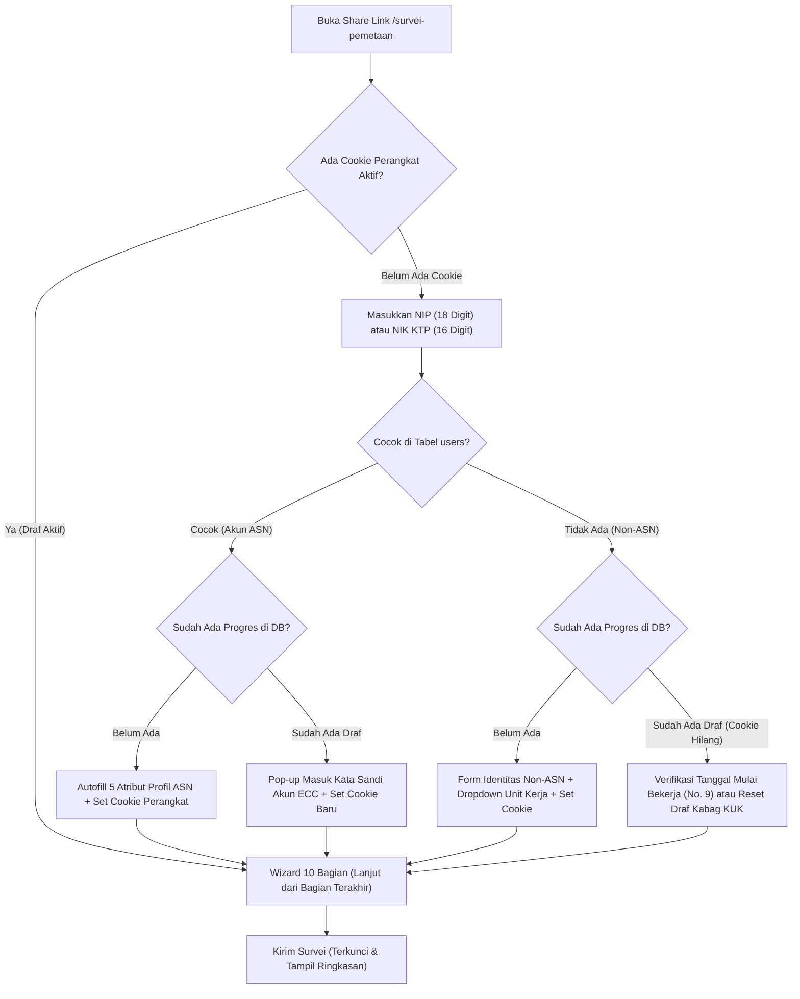

# Spesifikasi & Rancang Bangun Modul Survei Pemetaan Potensi, Kompetensi, dan Kapasitas Pegawai PKTJ
*Evidence Command Center (ECC) — Politeknik Keselamatan Transportasi Jalan*

---

## 1. Ringkasan Eksekutif & Latar Belakang

Dokumen ini memuat spesifikasi teknis dan fungsional lengkap dari instrumen resmi **Kuesioner Survei Pemetaan Potensi, Kompetensi, dan Kapasitas Pegawai PKTJ** (*Employee Competency, Potential & Workforce Capacity Mapping*) yang terdiri atas **10 Bagian** dan **83 Butir Pertanyaan**.

Modul ini dirancang sebagai **halaman formulir survei mandiri berbasis tautan bagikan (*Share-Link Only & Full No-Login*)** pada aplikasi **Evidence Command Center (ECC)**. Formulir survei **hanya diakses melalui tautan resmi yang dibagikan** (tanpa tombol di halaman `/login` dan tanpa menu pengisian di sidebar pegawai umum), melayani seluruh pegawai **ASN (PNS & PPPK pemilik akun ECC)** maupun **Non-ASN (yang tidak memiliki akun ECC)** melalui empat kapabilitas inti:
1. **Akses Eksklusif Tautan Bagikan (*Share-Link*) Tanpa Login + Autofill Akun ECC**:
   - Pegawai membuka tautan survei yang dibagikan oleh Bagian KUK, lalu memasukkan **NIP (18 digit)** bagi ASN atau **NIK KTP (16 digit)** bagi Non-ASN pada awal Bagian I.
   - Apabila NIP cocok dengan data pegawai aktif di tabel `users`, sistem otomatis melakukan *autofill* data profil yang sudah tersedia (`nama_lengkap`, `pangkat`, `jabatan`, `unit`) sehingga tidak perlu diketik ulang. Apabila NIK tidak terdaftar di `users` (pegawai Non-ASN), formulir otomatis membuka kolom identitas lengkap beserta pilihan Unit Kerja PKTJ.
2. **Penyimpanan Progres Bertahap (*Cookie + Verifikasi Login ASN*)**:
   - **ASN (Pemilik Akun ECC)**: Di perangkat yang sama otomatis tersambung lewat *HttpOnly Signed Cookie*; apabila pindah perangkat atau *cookie* terhapus ketika progres sudah ada, ASN dapat langsung melanjutkan dengan **verifikasi masuk akun ECC (Kata Sandi ECC)** lewat pop-up di halaman survei.
   - **Non-ASN (Tanpa Akun ECC)**: Melanjutkan progres melalui *HttpOnly Signed Cookie* pada peramban/perangkat yang sama (tanpa kode tambahan), dilengkapi penyelamat anti-*deadlock* melalui klaim Tanggal Mulai Bekerja (No. 9) atau tombol *Reset Draf* oleh Kabag KUK & staf delegasinya bila berganti peramban.
3. **Pelengkapan Profil Terlindungi (*Protected Smart Profile Sync*)**:
   - Bagi pemilik akun ECC yang kolom profilnya masih kosong (misal `jabatan` atau `pangkat`), kolom tersebut tampil aktif untuk dilengkapi. Jika identitasnya telah terverifikasi lewat login ECC (saat melanjutkan survei maupun saat login ke ECC berikutnya), data otomatis memperbarui tabel `users`; jika diselesaikan murni lewat *cookie* tanpa login, pembaruan ditandai `pending_profile_sync = 1` dan dapat disetujui 1 klik oleh **Kabag KUK** di halaman Hasil Survei.
4. **Kalkulasi Progres Dinamis & Validasi Kondisional**: Persentase kelengkapan (0%–100%) menyesuaikan secara cerdas terhadap cabang pertanyaan bersyarat sehingga setiap responden (ASN maupun Non-ASN) mencapai 100% secara akurat.

### Tujuan Survei (Sesuai Dokumen Resmi PDF):
1. Membangun data profil komprehensif seluruh pegawai.
2. Memetakan kompetensi utama dan keahlian tambahan.
3. Mengidentifikasi kapasitas dan kesediaan bekerja lintas unit.
4. Mengukur motivasi dan kesiapan mengembangkan kompetensi.
5. Mengidentifikasi potensi kontribusi terhadap kegiatan BLU.
6. Menjadi dasar perencanaan SDM, pengembangan pegawai, distribusi pekerjaan, dan penghargaan berbasis kinerja.

> **Catatan Mikro-Kopi Antarmuka (Kepatuhan Aturan Bahasa ECC)**: Pada tampilan layar pengguna, istilah teknis seperti *"database"* pada teks pengantar dihaluskan menjadi *"data profil pegawai"* (kecuali pada teks opsi resmi kuesioner No. 20: *"Pengelolaan jaringan dan database"*).

---

## 2. Identifikasi Masalah & Mitigasi Arsitektur (Full Tanpa Login via Share Link + Non-ASN)

Menjalankan formulir survei penuh tanpa login melalui *share link* sambil tetap melakukan *autofill* dari data akun pegawai ECC memiliki **8 potensi masalah keamanan, integritas data, dan kelancaran pengisian** yang dimitigasi sebagai berikut:

| No. | Identifikasi Masalah & Risiko | Dampak Jika Tidak Ditangani | Solusi & Mitigasi Arsitektur ECC |
| :-: | :--- | :--- | :--- |
| **1** | **Perusakan Data Master `users` Tanpa Kata Sandi (*Impersonation*)** | NIP ASN mudah diketahui. Jika pengisian tanpa login langsung menimpa tabel `users`, pihak iseng yang mengetik NIP rekannya lebih dulu dapat mengubah jabatan/unit pegawai tersebut. | **Sinkronisasi Terverifikasi**: Update langsung ke `users` hanya dijalankan saat identitas pemilik akun ECC terverifikasi Kata Sandi ECC (saat melanjutkan draf via login atau otomatis tersinkron saat ASN login ke ECC berikutnya). Jika selesai murni lewat *cookie*, ditandai `pending_profile_sync = 1` untuk disetujui 1 klik oleh Kabag KUK. |
| **2** | **Panen Data Pegawai lewat Endpoint Autofill (*User Enumeration & Scraping*)** | Pihak luar dapat memindai daftar NIP secara massal atau melihat daftar nama pegawai jika ada fitur *autocomplete* terbuka. | **Exact-Match Only & Throttling**: Tanpa *dropdown* pencarian nama publik dan halaman diproteksi `noindex, nofollow`. Autofill hanya berjalan pada kecocokan persis NIP 18 digit, dibatasi maks. **10 permintaan/menit/IP** (`Services::throttler()`), dan hanya mengembalikan 5 atribut dasar Bagian I (`nama_lengkap`, `pangkat`, `jabatan`, `unit`, `unit_id`). |
| **3** | **Pengintipan & Pembajakan Draf Jawaban ASN oleh Rekan Kerja** | Jika melanjutkan draf hanya bermodal mengetik NIP di komputer lain, rekan kerja dapat membaca keluhan pribadi pegawai (Bagian VI–X) atau mengubah isiannya. | **Cookie Perangkat + Verifikasi Kata Sandi ECC**: Ketika progres ASN sudah ada tetapi *cookie* perangkat tidak cocok, isi jawaban **dikunci** dan responden wajib memasukkan **Kata Sandi akun ECC** milik NIP tersebut untuk melanjutkan. |
| **4** | **Deadlock Cookie pada Non-ASN (Buka dari WhatsApp lalu Pindah ke Chrome/Safari)** | *Cookie* di *in-app browser* WhatsApp terpisah dari Chrome/Safari. Jika *cookie* hilang, Non-ASN tidak punya akun login sehingga terkunci (tidak bisa lanjut draf lama & tidak bisa mulai baru). | **Penyelamat Anti-Deadlock Tanpa Kode**: Non-ASN melanjutkan lewat *HttpOnly Signed Cookie* (30 hari). Bila pindah peramban/*cookie* terhapus, dapat menautkan ulang *cookie* dengan memverifikasi **Tanggal Mulai Bekerja di PKTJ (No. 9)** yang sudah tersimpan di Bagian I (maks. 5 percobaan/IP), atau dibantu tombol **Reset Draf** oleh Kabag KUK & staf delegasi. |
| **5** | **Pegawai Non-ASN Tidak Memiliki `user_id` maupun NIP 18 Digit** | Skema tabel yang mewajibkan `user_id NOT NULL` akan menolak seluruh responden Non-ASN (pramubakti, keamanan, pengemudi, teknisi, tenaga pendukung BLU). | **Kunci Identitas Hibrida (`nomor_identitas`)**: Kolom `user_id` dibuat `NULL`-able. Kunci unik menggunakan `(nomor_identitas, tahun_survei)` yang menerima **NIP 18 digit** (`tipe_responden = 'akun_ecc'`) maupun **NIK KTP 16 digit** (`tipe_responden = 'non_akun'`). |
| **6** | **Distorsi Persentase Keterisian `> 100%` di Dashboard Kabag KUK** | Jika total responden masuk (ASN + Non-ASN) dibagi jumlah akun tabel `users` (hanya ASN), angka keterisian bisa melampaui 100%. | **Pemisahan KPI Populasi**: Kartu keterisian memisahkan secara tegas **Keterisian Pegawai Akun ECC / ASN** (`X / Total ASN Aktif — Y%` beserta daftar nama yang belum mengisi) dari **Partisipasi Pegawai Non-ASN** (`Z Responden Terkirim`). |
| **7** | **Spam Bot Publik & Entri NIK Salah Ketik** | Tautan publik yang bocor berisiko dimasuki bot otomatis atau Non-ASN yang salah ketik NIK lalu mengisi ulang. | **Honeypot, Saklar Periode & Moderasi**: Dilengkapi *honeypot* anti-bot, validasi ketat panjang digit (16 atau 18 angka), **Saklar Buka/Tutup Tautan Survei**, serta aksi **Arsipkan Data Tidak Valid** (`is_valid = 0`) pada halaman Hasil Survei. |
| **8** | **Tampilan Mandiri Tanpa Pintu Login & Ketahanan CSRF** | Formulir hanya boleh diakses lewat *share link* (tanpa tombol di halaman `/login` maupun menu pegawai biasa), dan tab ponsel yang terbuka `> 2 jam` berisiko habis masa token CSRF. | **Standalone Clean Layout & Penyegaran CSRF**: Menggunakan halaman mandiri penuh tanpa sidebar ECC, menyediakan tombol **Salin Tautan Survei** khusus di halaman Hasil Survei Kabag KUK & staf delegasi, serta dilengkapi penyegaran token CSRF berkala dan cadangan lokal sementara di peramban. |

---

## 3. Strategi Autofill Identitas, Melanjutkan Progres & Sinkronisasi Profil

Seluruh responden mengakses formulir melalui satu pintu **Tautan Survei** (`/survei-pemetaan`) tanpa perlu login di awal. Bagian I dimulai dengan langkah pengenalan identitas berdasarkan **NIP (18 digit)** atau **NIK KTP (16 digit)**:

### A. Skenario Pengisian Awal & Melanjutkan Progres

1. **Responden ASN (Pemilik Akun ECC — NIP 18 Digit)**:
   - **Mulai Baru**: Mengetik NIP 18 digit $\rightarrow$ sistem mencocokkan ke tabel `users`, melakukan *autofill* atribut profil yang sudah tersedia (`nama_lengkap`, `pangkat`, `jabatan`, `unit`), membuka input aktif bagi atribut yang masih kosong, dan menanamkan *HttpOnly Signed Cookie* (`resume_token`) di perangkat tersebut.
   - **Melanjutkan Progres**:
     - Di perangkat/peramban yang sama (*cookie* cocok): langsung melanjutkan dari bagian terakhir (`last_step`) tanpa perlu login.
     - Di perangkat berbeda / *cookie* terhapus: muncul dialog ringkas **"Masukkan Kata Sandi ECC"** untuk NIP tersebut (atau otomatis lolos bila peramban sedang memiliki sesi login ECC aktif milik NIP yang sama), lalu menanamkan *cookie* baru dan membuka draf jawaban.
2. **Responden Non-ASN (Tanpa Akun ECC — NIK KTP 16 Digit)**:
   - **Mulai Baru**: Mengetik NIK KTP 16 digit $\rightarrow$ sistem mengenali sebagai `non_akun`, menyarankan **No. 5 Status Kepegawaian = `Non-ASN`**, menjadikan **No. 6 Pangkat/Golongan** opsional, membuka kolom Nama Lengkap, Jabatan, serta dropdown Unit Kerja (dari master `unit_kerja` PKTJ), dan menanamkan *HttpOnly Signed Cookie* (berlaku 30 hari).
   - **Melanjutkan Progres**:
     - Di perangkat/peramban yang sama (*cookie* cocok): langsung melanjutkan dari bagian terakhir secara otomatis.
     - Bila *cookie* hilang karena berganti peramban: responden dapat memverifikasi **Tanggal Mulai Bekerja di PKTJ (No. 9)** yang telah tersimpan pada Bagian I (maks. 5 percobaan) untuk menautkan ulang *cookie*, atau meminta **Kabag KUK / staf delegasi** menekan *Reset Draf*.

### B. Matriks Perlakuan Atribut Profil pada Bagian I

| No. | Pertanyaan Survei | Responden Akun ECC (Data di `users` Sudah Ada) | Responden Akun ECC (Data di `users` Kosong) | Responden Non-ASN (Tanpa Akun ECC) | Aturan Sinkronisasi ke Tabel `users` |
| :-: | :--- | :--- | :--- | :--- | :--- |
| **2** | NIP / NIK pegawai *(Pemicu Awal)* | Input **NIP 18 digit** pemicu *Autofill* | Input **NIP 18 digit** / NIK | Input aktif **NIK 16 digit** (**Wajib**) | Khusus `non_akun` hanya disimpan di tabel survei |
| **1** | Nama lengkap | Otomatis *Autofill* (*Read-Only*) | Input teks aktif (**Wajib**, maks. 100 karakter) | Input teks aktif (**Wajib**, maks. 100 karakter) | Langsung jika terverifikasi login ECC; *staged* (`pending_profile_sync`) jika *cookie-only* |
| **6** | Pangkat dan golongan *(jika ada)* | Otomatis *Autofill* (*Read-Only*) | Input teks + `datalist` Golongan (**Wajib** bagi `PNS`/`PPPK`) | **Opsional** (*"Kosongkan jika tidak ada"*) | Langsung jika terverifikasi login ECC; *staged* jika *cookie-only* |
| **7** | Jabatan saat ini | Otomatis *Autofill* (*Read-Only*) | Input teks aktif (**Wajib**, menghormati *Smart Lock*) | Input teks aktif (**Wajib**, maks. 100 karakter) | Langsung jika terverifikasi login ECC; *staged* jika *cookie-only* |
| **8** | Unit kerja saat ini | Otomatis *Autofill* (*Read-Only*, atau *"Pimpinan Institusi"*) | Dropdown `<select>` master `unit_kerja` (**Wajib**) | Dropdown `<select>` master `unit_kerja` (**Wajib**) | **Dual-Sync** `unit` & `unit_id` (langsung via verifikasi login / *staged* via *cookie*) |

### C. Pengamanan Integritas Data & Kelayakan Responden
1. **Larangan Menyentuh `users.status_pegawai`**: Jawaban **No. 5** (`PNS` / `PPPK` / `Non-ASN` / `Lainnya`) adalah jenis ikatan kerja dan **DILARANG** ditulis ke kolom `users.status_pegawai` (`aktif`/`mutasi_keluar`/`pensiun`/`nonaktif`).
2. **Penolakan Otomatis Akun Mutasi / Pensiun / Nonaktif**: Apabila NIP yang dimasukkan pada mode tanpa login cocok dengan akun `users` berstatus `nonaktif`, atau `mutasi_keluar`/`pensiun` yang sudah melewati `tmt_selesai`, sistem menolak pembuatan survei baru dengan pesan tenang: *"Pengisian survei tidak berlaku untuk akun yang telah selesai masa penugasan di PKTJ."*
3. **Kepatuhan *Smart Lock* (`riwayat_atasan`) & Snapshot Historis**: Atribut yang dikunci pada `riwayat_atasan` tidak dapat ditimpa, dan seluruh identitas Bagian I selalu disalin ke `snapshot_*` agar histori survei tahunan tetap utuh.
4. **Saran Awal Cerdas (*Editable Auto-Suggestion*)**:
   - Bagi pemilik **NIP 18 digit**: saran awal **No. 3 (Jenis kelamin)** diambil dari digit ke-15 dan **No. 4 (Usia)** dari 8 digit awal tanggal lahir (tetap dapat diubah).
   - Bagi pemilik **NIK 16 digit (Non-ASN)**: **No. 3** dan **No. 4** diisi langsung oleh responden agar akurat tanpa risiko salah tafsir kode wilayah KTP.

---

## 4. Rincian Lengkap Struktur Pertanyaan (83 Butir Pertanyaan Sesuai PDF)

### BAGIAN I. IDENTITAS DAN PROFIL PEGAWAI (*Data Administratif*)
*Tujuan: Membangun data profil dasar pegawai. (Pada tampilan antarmuka tanpa login, input No. 02 ditempatkan paling atas sebagai pemicu autofill, namun nomor urut dan ekspor Excel tetap mempertahankan urutan baku 01 s.d. 14 sesuai PDF).*

* **01. Nama lengkap**
  * *Sumber & Tipe Input*: *Autofill Editable* dari akun `users` bagi ASN (agar pegawai dapat menyesuaikan penulisan nama beserta gelar) atau Teks Singkat (**Wajib**) bagi Non-ASN.
* **02. NIP/NIK pegawai**
  * *Sumber & Tipe Input*: **NIP 18 digit** bagi ASN (memicu *autofill* akun ECC) atau **NIK KTP 16 digit** bagi Non-ASN (**Wajib**, hanya angka `tabular-nums`).
* **03. Jenis kelamin**
  * *Tipe Input*: Pilihan Tunggal (*Radio Button*) — *Auto-suggest editable* dari digit ke-15 NIP khusus NIP 18 digit.
  * *Opsi*: `Laki-laki` | `Perempuan`
* **04. Usia**
  * *Tipe Input*: Angka (*Number Input*, dalam satuan tahun, rentang validasi `17`–`75`, `tabular-nums`) — *Auto-suggest editable* dari 8 digit awal khusus NIP 18 digit.
* **05. Status kepegawaian**
  * *Tipe Input*: Pilihan Tunggal (*Radio Button*) + input teks kondisional jika memilih `Lainnya` (otomatis menyarankan `Non-ASN` apabila responden masuk dengan NIK 16 digit yang tidak terdaftar di `users`).
  * *Opsi*: `PNS` | `PPPK` | `Non-ASN` | `Lainnya` *(sebutkan)*
* **06. Pangkat dan golongan (jika ada)**
  * *Sumber & Tipe Input*: *Autofill Read-Only* jika sudah terisi di akun `users`; Teks Singkat + `datalist` standar Pangkat/Golongan jika kosong.
  * *Aturan Kondisional*: **Wajib** diisi jika No. 5 = `PNS` atau `PPPK`; **Opsional** (*"Kosongkan jika tidak ada"*) jika No. 5 = `Non-ASN` atau `Lainnya`.
* **07. Jabatan saat ini**
  * *Sumber & Tipe Input*: *Autofill Read-Only* jika sudah terisi di akun `users` (atau dikunci `riwayat_atasan`); Teks Singkat (**Wajib**) bagi Non-ASN atau akun `users` yang jabatannya masih kosong.
* **08. Unit kerja saat ini**
  * *Sumber & Tipe Input*: *Autofill Read-Only* jika sudah terisi di akun `users` (atau *"Pimpinan Institusi"* bagi `direktur`/`wadir`/`admin`); Dropdown `<select>` dari master `unit_kerja` PKTJ (**Wajib**) bagi seluruh Non-ASN maupun akun `users` yang unitnya masih kosong.
* **09. Tanggal mulai bekerja di PKTJ**
  * *Tipe Input*: Tanggal (*Flatpickr Datepicker*, validasi `<= hari ini`).
* **10. Masa kerja di PKTJ**
  * *Tipe Input*: **Otomatis dihitung** secara *real-time* dari Tanggal Mulai Bekerja pada No. 9 (menampilkan teks presisi misal *"4 Tahun 3 Bulan"* sekaligus menyimpan angka tahun desimal dan kategori rentang: `Kurang dari 1 tahun`, `1–3 tahun`, `4–6 tahun`, `7–10 tahun`, `Lebih dari 10 tahun`).
* **11. Pendidikan terakhir**
  * *Tipe Input*: Pilihan Tunggal (*Radio Button / Dropdown*).
  * *Opsi*: `SMA/SMK` | `D3` | `D4` | `S1` | `S2` | `S3`
* **12. Program studi/jurusan pendidikan terakhir**
  * *Tipe Input*: Teks Singkat (*Text Input*, maks. 150 karakter, *placeholder*: `"Contoh: Transportasi / Teknik Sipil / Manajemen"`).
* **13. Apakah memiliki sertifikat profesi atau sertifikasi kompetensi?**
  * *Tipe Input*: Pilihan Tunggal (`Ya` | `Tidak`).
* **14. Jika ya, sebutkan sertifikasi yang dimiliki**
  * *Tipe Input*: Jawaban Panjang (*Textarea*).
  * *Aturan Kondisional*: **Hanya muncul dan wajib diisi jika No. 13 = `Ya`**. Jika No. 13 = `Tidak`, disembunyikan dan dilewati dari perhitungan beban progres.

---

### BAGIAN II. DOMISILI DAN AKSESIBILITAS TEMPAT KERJA (*Workforce Demographic Mapping*)
*Tujuan: Mengetahui kondisi mobilitas pegawai dan potensi pengaturan penugasan.*

* **15. Di kecamatan/kota mana tempat tinggal Anda saat ini?**
  * *Tipe Input*: Teks Singkat (*Text Input*, contoh: *"Margadana, Kota Tegal"*).
  * *Catatan Privasi (Sesuai Halaman 2 PDF)*: Tampilkan teks bantu singkat di bawah input: *"Cukup tuliskan kecamatan dan kota/kabupaten, tanpa alamat lengkap rumah."*
* **16. Berapa perkiraan jarak tempat tinggal ke kantor PKTJ?**
  * *Tipe Input*: Pilihan Tunggal (*Radio Button*).
  * *Opsi*:
    1. Kurang dari 5 km
    2. 5–10 km
    3. 11–20 km
    4. 21–30 km
    5. Lebih dari 30 km
* **17. Berapa rata-rata waktu perjalanan dari rumah ke kantor?**
  * *Tipe Input*: Pilihan Tunggal (*Radio Button*).
  * *Opsi*:
    1. Kurang dari 15 menit
    2. 15–30 menit
    3. 31–60 menit
    4. 1–2 jam
    5. Lebih dari 2 jam
* **18. Apa moda transportasi utama yang digunakan?**
  * *Tipe Input*: Pilihan Tunggal (*Radio Button*) + input teks kondisional jika memilih `Lainnya`.
  * *Opsi*: `Kendaraan pribadi` | `Transportasi umum` | `Kendaraan dinas` | `Lainnya` *(sebutkan)*
* **19. Apakah Anda memiliki keterbatasan mobilitas yang memengaruhi pelaksanaan tugas kedinasan tertentu?**
  * *Tipe Input*: Pilihan Tunggal + Keterangan Teks Opsional.
  * *Opsi*: `Tidak` | `Ya, jelaskan secara opsional` *(muncul kolom teks opsional di `jawaban_lainnya` jika memilih `Ya`, tidak memblokir pengiriman apabila dikosongkan)*.

---

### BAGIAN III. KOMPETENSI DAN KEAHLIAN PEGAWAI (*Competency Mapping*)
*Tujuan: Mengetahui kompetensi utama dan keahlian tambahan yang benar-benar dapat dimanfaatkan oleh organisasi.*

* **20. Apa bidang kompetensi utama yang Anda kuasai saat ini?**
  * *Tipe Input*: Pilihan Ganda (*Checkbox* — **Boleh memilih lebih dari satu**, minimal 1 pilihan) + input teks jika mencentang `Lainnya`.
  * *Opsi*:
    1. Administrasi perkantoran
    2. Pengelolaan keuangan dan anggaran
    3. Akuntansi dan pelaporan keuangan
    4. Pengelolaan kepegawaian dan SDM
    5. Perencanaan dan evaluasi program
    6. Pengadaan barang dan jasa
    7. Teknologi informasi dan komputer
    8. Pemrograman dan pengembangan aplikasi
    9. Pengelolaan jaringan dan database
    10. Pendidikan dan pengajaran
    11. Penelitian dan pengembangan
    12. Keselamatan transportasi jalan
    13. Pengujian kendaraan bermotor
    14. Pelatihan dan sertifikasi
    15. Pengelolaan sarana dan prasarana
    16. Humas dan komunikasi publik
    17. Pemasaran dan promosi
    18. Pengelolaan bisnis dan kerja sama
    19. Pelayanan masyarakat
    20. Lainnya *(sebutkan)*
* **21. Selain kompetensi utama pekerjaan Anda, apakah Anda memiliki keahlian tambahan yang dapat dimanfaatkan untuk mendukung pekerjaan unit lain?**
  * *Tipe Input*: Pilihan Tunggal (*Radio Button*).
  * *Opsi*:
    1. Ya, memiliki beberapa keahlian tambahan
    2. Ya, memiliki satu keahlian tambahan
    3. Belum memiliki keahlian tambahan
    4. Belum mengetahui keahlian lain yang dapat dimanfaatkan
* **22. Jika memiliki keahlian tambahan, sebutkan keahlian tersebut.**
  * *Tipe Input*: Jawaban Terbuka (*Textarea*).
  * *Petunjuk (Sesuai PDF)*: Contoh: desain grafis, fotografi, videografi, *public speaking*, bahasa Inggris, bahasa asing, pengelolaan media sosial, Microsoft Excel tingkat lanjut, analisis data, pemrograman, *digital marketing*, penulisan laporan, dan sebagainya.
  * *Aturan Kondisional (Berlaku untuk No. 22 s.d. No. 25)*: **Hanya aktif dan wajib diisi apabila No. 21 dijawab opsi 1 atau opsi 2 (*"Ya, memiliki..."*)**. Apabila No. 21 dijawab opsi 3 atau 4 (*"Belum..."*), maka No. 22–25 otomatis disembunyikan/dilewati agar tidak mendistorsi skor rata-rata penguasaan keahlian tambahan.
* **23. Seberapa baik tingkat penguasaan Anda terhadap keahlian tambahan tersebut?** *(Kondisional aktif jika No. 21 = Ya)*
  * *Tipe Input*: Skala 1 s.d. 5 (*Radio Scale*).
  * *Skala*:
    * **1** = Mengenal, tetapi belum mampu melaksanakan
    * **2** = Memahami dasar-dasarnya
    * **3** = Mampu melaksanakan dengan bimbingan
    * **4** = Mampu bekerja secara mandiri
    * **5** = Sangat menguasai dan mampu membimbing orang lain
* **24. Apakah Anda memiliki pengalaman menggunakan keahlian tambahan tersebut untuk pekerjaan atau menghasilkan suatu produk/jasa?** *(Kondisional aktif jika No. 21 = Ya)*
  * *Tipe Input*: Pilihan Tunggal (*Radio Button*).
  * *Opsi*:
    1. Belum pernah
    2. Pernah untuk kebutuhan pribadi
    3. Pernah membantu pekerjaan kantor
    4. Pernah mendapatkan penugasan resmi
    5. Pernah menghasilkan produk atau layanan yang memberikan nilai tambah bagi organisasi
* **25. Apakah Anda memiliki portofolio, sertifikat, atau bukti hasil pekerjaan yang menunjukkan keahlian tersebut?** *(Kondisional aktif jika No. 21 = Ya)*
  * *Tipe Input*: Pilihan Tunggal (*Radio Button*).
  * *Opsi*: `Ada` | `Tidak ada` | `Sedang dalam proses pengumpulan`
* **26. Keahlian apa yang menurut Anda perlu dikembangkan agar dapat memberikan kontribusi lebih besar kepada PKTJ?**
  * *Tipe Input*: Jawaban Terbuka (*Textarea* — **Wajib untuk seluruh responden**).

---

### BAGIAN IV. KEMAMPUAN DAN KESEDIAAN BEKERJA LINTAS UNIT (*Workforce Flexibility & Mobility*)
*Tujuan: Mengetahui apakah pegawai bersedia dan mampu membantu unit kerja lain ketika organisasi membutuhkan dukungan SDM.*

* **27. Apakah Anda bersedia membantu pekerjaan pada unit kerja lain di luar tugas utama Anda apabila dibutuhkan oleh organisasi?**
  * *Tipe Input*: Pilihan Tunggal (*Radio Button*).
  * *Opsi*:
    1. Sangat bersedia
    2. Bersedia
    3. Bersedia dengan mempertimbangkan jenis pekerjaan dan beban kerja
    4. Kurang bersedia
    5. Tidak bersedia
* **28. Apabila Anda bersedia membantu unit lain, jenis pekerjaan seperti apa yang dapat Anda lakukan?**
  * *Tipe Input*: Pilihan Ganda (*Checkbox* — **Boleh memilih lebih dari satu**) + input teks jika mencentang `Lainnya`.
  * *Aturan Kondisional*: Wajib diisi (minimal 1 pilihan) apabila No. 27 **selain** `"Tidak bersedia"`; disembunyikan/opsional apabila No. 27 = `"Tidak bersedia"`.
  * *Opsi*:
    1. Pekerjaan administrasi dan pengarsipan
    2. Pengolahan data dan penyusunan laporan
    3. Pengelolaan keuangan dan administrasi anggaran
    4. Pelayanan pendidikan dan pelatihan
    5. Kegiatan operasional lapangan
    6. Kegiatan pemasaran dan promosi layanan BLU
    7. Kegiatan pengelolaan usaha dan kerja sama
    8. Kegiatan penelitian dan pengembangan
    9. Pengelolaan teknologi informasi
    10. Kegiatan pendukung akademik dan kemahasiswaan
    11. Kegiatan pelayanan umum dan rumah tangga
    12. Lainnya *(sebutkan)*
* **29. Apakah Anda pernah membantu pekerjaan unit lain di luar tupoksi selama bekerja di PKTJ?**
  * *Tipe Input*: Pilihan Tunggal (`Sering` | `Beberapa kali` | `Pernah satu atau dua kali` | `Belum pernah`).
* **30. Jika pernah, pekerjaan apa yang pernah Anda lakukan dan unit mana yang Anda bantu?**
  * *Tipe Input*: Jawaban Terbuka (*Textarea*).
  * *Aturan Kondisional*: **Hanya muncul dan wajib diisi jika No. 29 selain `"Belum pernah"`**.
* **31. Apa pertimbangan utama Anda apabila diminta membantu pekerjaan di luar tupoksi?**
  * *Tipe Input*: Pilihan Terbatas (*Checkbox* — **Pilih maksimal tiga jawaban**, divalidasi di klien & server) + input teks jika mencentang `Lainnya`.
  * *Perilaku Eksklusif*: Jika mencentang opsi 10 (*"Tidak tertarik melakukan pekerjaan di luar tupoksi"*), opsi kesediaan 1–7 otomatis dilepas agar tidak terjadi jawaban kontradiktif.
  * *Opsi*:
    1. Ingin membantu organisasi mencapai target
    2. Ingin menambah pengalaman dan kompetensi
    3. Ingin memperoleh tantangan pekerjaan baru
    4. Ingin mendapatkan tambahan penghasilan atau penghargaan sesuai ketentuan
    5. Bersedia sepanjang tidak mengganggu tugas utama
    6. Bersedia sepanjang mendapatkan penugasan yang jelas
    7. Bersedia jika pekerjaan sesuai dengan keahlian
    8. Mempertimbangkan kondisi keluarga dan waktu pribadi
    9. Mempertimbangkan beban pekerjaan saat ini
    10. Tidak tertarik melakukan pekerjaan di luar tupoksi
    11. Lainnya *(sebutkan)*
* **32. Apabila unit kerja lain membutuhkan bantuan Anda, berapa besar kapasitas waktu yang secara realistis dapat Anda alokasikan untuk membantu pekerjaan tersebut dalam jam kerja normal?**
  * *Tipe Input*: Pilihan Tunggal (*Radio Button*).
  * *Opsi*:
    1. Kurang dari 2 jam per minggu
    2. 2–4 jam per minggu
    3. 5–8 jam per minggu
    4. Lebih dari 8 jam per minggu
    5. Belum dapat menentukan karena tergantung beban pekerjaan
* **33. Apakah Anda bersedia diberikan penugasan tambahan di luar jam kerja normal apabila terdapat kegiatan kedinasan yang mendesak?**
  * *Tipe Input*: Pilihan Tunggal (*Radio Button*).
  * *Opsi*:
    1. Sangat bersedia, sesuai ketentuan
    2. Bersedia dengan pemberitahuan sebelumnya
    3. Bersedia dengan mempertimbangkan jenis dan durasi pekerjaan
    4. Hanya dalam kondisi tertentu
    5. Tidak bersedia
* **34. Apa faktor yang paling memengaruhi kesediaan Anda melaksanakan pekerjaan tambahan di luar jam kerja?**
  * *Tipe Input*: Pilihan Ganda (*Checkbox* — **Boleh memilih lebih dari satu**) + input teks jika mencentang `Lainnya`.
  * *Opsi*:
    1. Kebutuhan organisasi
    2. Kejelasan surat tugas dan tanggung jawab
    3. Kompensasi atau penghargaan sesuai ketentuan
    4. Ketersediaan waktu pribadi
    5. Kondisi keluarga
    6. Kondisi kesehatan atau kemampuan fisik
    7. Jenis dan tingkat kesulitan pekerjaan
    8. Durasi dan frekuensi pekerjaan tambahan
    9. Lainnya *(sebutkan)*
* **35. Jika organisasi memberikan kesempatan kepada Anda untuk membantu unit yang kekurangan SDM, apakah Anda bersedia mengikuti mekanisme penugasan lintas unit secara berkala?**
  * *Tipe Input*: Pilihan Tunggal (*Radio Button*).
  * *Opsi*:
    1. Ya, sangat bersedia
    2. Ya, dengan mempertimbangkan kompetensi dan kapasitas
    3. Bersedia apabila ada kebutuhan mendesak
    4. Tidak bersedia

---

### BAGIAN V. KESEDIAAN MENGIKUTI PENDIDIKAN DAN PENGEMBANGAN KOMPETENSI (*Learning Agility & Employee Development*)
*Tujuan: Mengidentifikasi pegawai yang memiliki kemauan berkembang dan berpotensi menguasai kompetensi baru.*

* **36. Apakah Anda bersedia mengikuti pendidikan, pelatihan, atau sertifikasi untuk menguasai kompetensi baru di luar bidang pekerjaan Anda saat ini?**
  * *Tipe Input*: Pilihan Tunggal (*Radio Button*).
  * *Opsi*: `Sangat bersedia` | `Bersedia` | `Bersedia apabila kompetensi tersebut dibutuhkan organisasi` | `Kurang bersedia` | `Tidak bersedia`
* **37. Jika diberikan kesempatan mengikuti pelatihan, bidang apa yang paling ingin Anda pelajari?**
  * *Tipe Input*: Pilihan Ganda (*Checkbox* — **Boleh memilih lebih dari satu**) + input teks jika mencentang `Lainnya`.
  * *Opsi*:
    1. Teknologi informasi dan kecerdasan buatan (AI)
    2. Pengolahan data dan analisis data
    3. Administrasi dan manajemen perkantoran
    4. Keuangan dan akuntansi
    5. Manajemen bisnis dan kewirausahaan
    6. Pemasaran dan digital marketing
    7. Komunikasi dan public speaking
    8. Bahasa Inggris atau bahasa asing
    9. Pengelolaan pendidikan dan pelatihan
    10. Pengujian kendaraan bermotor
    11. Keselamatan transportasi jalan
    12. Penelitian dan penulisan ilmiah
    13. Pengadaan barang dan jasa
    14. Manajemen proyek
    15. Kepemimpinan dan manajemen organisasi
    16. Lainnya *(sebutkan)*
* **38. Apabila organisasi memberikan kesempatan pendidikan atau pelatihan, metode pembelajaran apa yang paling sesuai bagi Anda?**
  * *Tipe Input*: Pilihan Tunggal (*Radio Button*).
  * *Opsi*:
    1. Pelatihan tatap muka
    2. Pelatihan daring
    3. Pelatihan praktik langsung
    4. Magang atau belajar di unit kerja lain
    5. Pendampingan oleh pegawai yang lebih berpengalaman
    6. Kombinasi beberapa metode
* **39. Apakah Anda bersedia mengikuti pendidikan atau pelatihan yang dilaksanakan di luar kota atau di luar jam kerja normal apabila diperlukan?**
  * *Tipe Input*: Pilihan Tunggal (*Radio Button*).
  * *Opsi*: `Ya, bersedia` | `Bersedia dengan pemberitahuan sebelumnya` | `Bersedia dengan mempertimbangkan durasi dan kondisi pribadi` | `Tidak bersedia`
* **40. Menurut Anda, apakah penguasaan kompetensi baru dapat meningkatkan kontribusi Anda terhadap organisasi?**
  * *Tipe Input*: Skala Likert 1–5 (`1 = Sangat tidak setuju`, `2 = Tidak setuju`, `3 = Netral`, `4 = Setuju`, `5 = Sangat setuju`).
* **41. Apakah Anda bersedia apabila setelah mengikuti pelatihan diberikan penugasan untuk menerapkan kompetensi baru tersebut pada unit kerja lain?**
  * *Tipe Input*: Pilihan Tunggal (*Radio Button*).
  * *Opsi*: `Sangat bersedia` | `Bersedia` | `Bersedia dengan mempertimbangkan jenis penugasan` | `Kurang bersedia` | `Tidak bersedia`
* **42. Kompetensi apa yang menurut Anda saat ini paling dibutuhkan PKTJ tetapi belum tersedia atau masih terbatas jumlah pegawainya?**
  * *Tipe Input*: Jawaban Terbuka (*Textarea*).

---

### BAGIAN VI. MOTIVASI, INISIATIF, DAN PERILAKU KERJA (*Employee Behavioral & Motivation Mapping*)
*Tujuan: Mengetahui kecenderungan perilaku kerja pegawai menggunakan Skala Likert 1–5.*

* **43 s.d. 55. Penilaian Pernyataan Perilaku Kerja**
  * *Tipe Input*: Matriks Skala Likert 1–5 di layar desktop; otomatis menjadi *Stacked Rating Cards* dengan tombol sentuh `min-height: 44px` di layar ponsel:
    * `1 = Sangat tidak setuju` | `2 = Tidak setuju` | `3 = Netral` | `4 = Setuju` | `5 = Sangat setuju`
  * *Daftar Pernyataan*:
    * **43.** Saya berusaha menyelesaikan pekerjaan dengan hasil terbaik meskipun tidak selalu diawasi oleh atasan.
    * **44.** Saya memiliki inisiatif untuk mencari solusi ketika menghadapi permasalahan pekerjaan.
    * **45.** Saya bersedia mempelajari hal baru untuk meningkatkan kemampuan kerja.
    * **46.** Saya memiliki keinginan untuk memberikan kontribusi lebih besar bagi kemajuan PKTJ.
    * **47.** Saya bersedia membantu rekan kerja yang mengalami kesulitan dalam menyelesaikan pekerjaan.
    * **48.** Saya mampu menyesuaikan diri ketika organisasi mengalami perubahan kebijakan atau sistem kerja.
    * **49.** Saya berusaha menyelesaikan pekerjaan sesuai target dan batas waktu yang ditentukan.
    * **50.** Saya tertarik terlibat dalam kegiatan inovasi yang dapat meningkatkan kualitas pelayanan PKTJ.
    * **51.** Saya memahami bahwa keberhasilan organisasi merupakan tanggung jawab seluruh pegawai.
    * **52.** Saya bersedia menerima tanggung jawab baru apabila organisasi membutuhkan kemampuan saya.
    * **53.** Saya berusaha mencari cara agar pekerjaan dapat dilaksanakan lebih efektif dan efisien.
    * **54.** Saya memiliki motivasi untuk menghasilkan pekerjaan yang memberikan manfaat nyata bagi organisasi.
    * **55.** Saya terbuka terhadap evaluasi dan masukan untuk memperbaiki hasil pekerjaan saya.
* **56. Menurut Anda, apa yang paling memotivasi Anda untuk memberikan kinerja terbaik?**
  * *Tipe Input*: Pilihan Terbatas (*Checkbox* — **Pilih maksimal tiga**, divalidasi di klien & server) + input teks jika mencentang `Lainnya`.
  * *Opsi*:
    1. Kesempatan mengembangkan karier
    2. Penghargaan atas hasil kerja
    3. Tambahan penghasilan sesuai ketentuan
    4. Lingkungan kerja yang baik
    5. Pengakuan dari pimpinan
    6. Kesempatan mengikuti pendidikan
    7. Tantangan dan variasi pekerjaan
    8. Kesempatan berinovasi
    9. Keinginan memberikan kontribusi kepada organisasi
    10. Tanggung jawab profesional
    11. Lainnya *(sebutkan)*
* **57. Apa hambatan utama yang selama ini memengaruhi produktivitas atau kinerja Anda?**
  * *Tipe Input*: Pilihan Ganda (*Checkbox* — **Boleh memilih lebih dari satu**) + input teks jika mencentang `Lainnya`.
  * *Perilaku Eksklusif*: Jika mencentang opsi 11 (*"Tidak ada hambatan berarti"*), pilihan hambatan 1–10 otomatis dilepas.
  * *Opsi*:
    1. Beban pekerjaan terlalu banyak
    2. Jumlah pegawai pada unit kerja terbatas
    3. Pembagian pekerjaan kurang merata
    4. Keterbatasan kompetensi atau keterampilan
    5. Keterbatasan fasilitas dan sarana kerja
    6. Sistem atau prosedur kerja kurang efektif
    7. Kurangnya koordinasi antarunit
    8. Kurangnya motivasi
    9. Kurangnya dukungan pimpinan
    10. Kurangnya penghargaan terhadap hasil kerja
    11. Tidak ada hambatan berarti
    12. Lainnya *(sebutkan)*
* **58. Menurut Anda, apa yang perlu diperbaiki oleh PKTJ agar seluruh pegawai dapat bekerja lebih produktif?**
  * *Tipe Input*: Jawaban Terbuka (*Textarea*).

---

### BAGIAN VII. KESIAPAN MENDUKUNG PENINGKATAN PENDAPATAN BLU PKTJ (*BLU Business Contribution Mapping*)
*Tujuan: Memetakan kesiapan strategis pegawai yang berkaitan langsung dengan peningkatan pendapatan BLU.*

* **59. Apakah Anda mengetahui jenis layanan atau kegiatan PKTJ yang dapat menghasilkan pendapatan BLU?**
  * *Tipe Input*: Pilihan Tunggal (*Radio Button*).
  * *Opsi*: `Mengetahui dengan baik` | `Mengetahui sebagian` | `Pernah mendengar tetapi belum memahami` | `Belum mengetahui`
* **60. Apakah Anda tertarik terlibat dalam kegiatan yang dapat meningkatkan pendapatan BLU PKTJ?**
  * *Tipe Input*: Pilihan Tunggal (*Radio Button*).
  * *Opsi*: `Sangat tertarik` | `Tertarik` | `Tertarik apabila sesuai kompetensi` | `Belum memiliki ketertarikan` | `Tidak tertarik`
* **61. Dalam kegiatan apa Anda bersedia berkontribusi untuk mendukung pendapatan BLU?**
  * *Tipe Input*: Pilihan Ganda (*Checkbox* — **Boleh memilih lebih dari satu**) + input teks jika mencentang `Lainnya`.
  * *Opsi*:
    1. Pelaksanaan pendidikan dan pelatihan
    2. Pelayanan pengujian kendaraan bermotor
    3. Pelaksanaan sertifikasi kompetensi
    4. Pemasaran dan promosi layanan PKTJ
    5. Pengembangan kerja sama dengan instansi pemerintah
    6. Pengembangan kerja sama dengan perusahaan swasta
    7. Pengembangan produk atau layanan baru
    8. Pengelolaan aset dan fasilitas yang berpotensi menghasilkan pendapatan
    9. Pengelolaan administrasi dan keuangan kegiatan BLU
    10. Pengembangan teknologi informasi untuk layanan BLU
    11. Penelitian dan konsultasi di bidang transportasi
    12. Kegiatan kewirausahaan dan pengembangan usaha
    13. Lainnya *(sebutkan)*
* **62. Apakah Anda memiliki pengalaman dalam kegiatan bisnis, pemasaran, penjualan jasa, kerja sama, atau pengembangan usaha?**
  * *Tipe Input*: Pilihan Tunggal (*Radio Button*).
  * *Opsi*: `Memiliki pengalaman profesional` | `Pernah terlibat dalam kegiatan tersebut` | `Memiliki pengalaman pribadi atau usaha sampingan` | `Belum memiliki pengalaman`
* **63. Apabila diberikan kesempatan, apakah Anda bersedia membantu mencari peluang kerja sama atau calon pengguna jasa layanan PKTJ?**
  * *Tipe Input*: Pilihan Tunggal (*Radio Button*).
  * *Opsi*: `Sangat bersedia` | `Bersedia` | `Bersedia apabila mendapatkan pembekalan` | `Kurang bersedia` | `Tidak bersedia`
* **64. Apakah Anda memiliki jaringan atau relasi profesional dengan instansi pemerintah, BUMN, perusahaan swasta, asosiasi, atau lembaga lain yang berpotensi menjadi mitra PKTJ?**
  * *Tipe Input*: Pilihan Tunggal (*Radio Button*).
  * *Opsi*: `Ya, memiliki jaringan yang relevan` | `Ada, tetapi belum pernah dimanfaatkan` | `Tidak memiliki jaringan yang relevan` | `Tidak bersedia menjawab`
* **65. Menurut Anda, kegiatan atau layanan apa yang memiliki peluang untuk dikembangkan PKTJ guna meningkatkan pendapatan BLU?**
  * *Tipe Input*: Jawaban Terbuka (*Textarea*).
* **66. Apabila PKTJ memberikan target tertentu untuk mendukung peningkatan pendapatan BLU, apakah Anda bersedia berkontribusi sesuai kompetensi dan penugasan yang diberikan?**
  * *Tipe Input*: Pilihan Tunggal (*Radio Button*).
  * *Opsi*: `Sangat bersedia` | `Bersedia` | `Bersedia apabila diberikan pelatihan dan pendampingan` | `Bersedia apabila tidak mengganggu pekerjaan utama` | `Kurang bersedia` | `Tidak bersedia`
* **67. Menurut Anda, bentuk kontribusi apa yang paling realistis dapat Anda berikan untuk membantu peningkatan pendapatan BLU?**
  * *Tipe Input*: Jawaban Terbuka (*Textarea*).

---

### BAGIAN VIII. KAPASITAS KERJA DAN KESIAPAN MENERIMA TANGGUNG JAWAB TAMBAHAN (*Workload & Capacity Assessment*)
*Tujuan: Menghindari kesalahan dalam menilai pegawai yang tidak bersedia menerima tugas tambahan karena memang sudah memiliki beban kerja tinggi.*

* **68. Bagaimana Anda menilai beban pekerjaan Anda saat ini?**
  * *Tipe Input*: Pilihan Tunggal (`Sangat ringan` | `Ringan` | `Sedang` | `Berat` | `Sangat berat`).
* **69. Apakah seluruh pekerjaan utama Anda saat ini dapat diselesaikan sesuai waktu dan target yang ditentukan?**
  * *Tipe Input*: Pilihan Tunggal (*Radio Button*).
  * *Opsi*:
    1. Selalu dapat diselesaikan
    2. Sebagian besar dapat diselesaikan
    3. Kadang-kadang mengalami keterlambatan
    4. Sering mengalami keterlambatan
    5. Tidak dapat diselesaikan karena keterbatasan waktu atau sumber daya
* **70. Apakah Anda merasa masih memiliki kapasitas untuk menerima tanggung jawab tambahan?**
  * *Tipe Input*: Pilihan Tunggal (*Radio Button*).
  * *Opsi*:
    1. Ya, kapasitas masih cukup besar
    2. Ya, tetapi terbatas
    3. Hanya untuk pekerjaan tertentu
    4. Saat ini tidak memiliki kapasitas tambahan
    5. Belum dapat menentukan
* **71. Jika diberikan pekerjaan tambahan, dukungan apa yang Anda perlukan?**
  * *Tipe Input*: Pilihan Ganda (*Checkbox* — **Boleh memilih lebih dari satu**) + input teks jika mencentang `Lainnya`.
  * *Opsi*:
    1. Pembagian tugas yang jelas
    2. Pelatihan atau peningkatan kompetensi
    3. Pendampingan dari pegawai berpengalaman
    4. Fasilitas dan peralatan kerja
    5. Dukungan administrasi
    6. Penyesuaian beban pekerjaan utama
    7. Penugasan resmi dari pimpinan
    8. Penghargaan sesuai ketentuan
    9. Lainnya *(sebutkan)*
* **72. Apakah Anda bersedia dievaluasi berdasarkan hasil pekerjaan tambahan yang diberikan kepada Anda?**
  * *Tipe Input*: Pilihan Tunggal (*Radio Button*).
  * *Opsi*: `Sangat bersedia` | `Bersedia` | `Bersedia dengan indikator penilaian yang jelas` | `Kurang bersedia` | `Tidak bersedia`

---

### BAGIAN IX. PERSEPSI TERHADAP SISTEM KINERJA DAN PENGHARGAAN (*Performance & Reward System*)
*Tujuan: Mengetahui pandangan pegawai terhadap sistem penghargaan yang akan dikembangkan PKTJ.*

* **73. Apakah menurut Anda pegawai yang memberikan kontribusi dan hasil kerja lebih besar seharusnya mendapatkan penghargaan lebih besar?**
  * *Tipe Input*: Pilihan Tunggal (*Radio Button* sesuai urutan cetak PDF, dengan mapping nilai numerik eksplisit di `jawaban_angka` agar arah polaritas analitik konsisten: **`Sangat setuju` = 5**, **`Setuju` = 4**, **`Netral` = 3**, **`Tidak setuju` = 2**, **`Sangat tidak setuju` = 1**).
  * *Opsi (Urutan PDF)*: `Sangat setuju` | `Setuju` | `Netral` | `Tidak setuju` | `Sangat tidak setuju`
* **74. Menurut Anda, faktor apa yang paling layak menjadi dasar pemberian penghargaan kepada pegawai?**
  * *Tipe Input*: Pilihan Terbatas (*Checkbox* — **Pilih maksimal lima**, divalidasi di klien & server) + input teks jika mencentang `Lainnya`.
  * *Opsi*:
    1. Pencapaian target pekerjaan
    2. Kualitas hasil pekerjaan
    3. Kedisiplinan
    4. Tanggung jawab
    5. Inisiatif dan inovasi
    6. Kontribusi membantu unit lain
    7. Penguasaan kompetensi tambahan
    8. Peningkatan produktivitas
    9. Kontribusi terhadap peningkatan pendapatan BLU
    10. Efisiensi penggunaan anggaran
    11. Kualitas pelayanan kepada masyarakat
    12. Kerja sama tim
    13. Lainnya *(sebutkan)*
* **75. Bentuk penghargaan apa yang paling Anda harapkan atas kontribusi dan hasil kerja yang baik?**
  * *Tipe Input*: Pilihan Ganda (*Checkbox* — **Boleh memilih lebih dari satu**) + input teks jika mencentang `Bentuk penghargaan lainnya`.
  * *Opsi*:
    1. Insentif finansial sesuai ketentuan
    2. Kesempatan mengikuti pendidikan atau pelatihan
    3. Pengembangan karier
    4. Pengakuan atau apresiasi dari pimpinan
    5. Penghargaan pegawai berprestasi
    6. Kesempatan mendapatkan penugasan strategis
    7. Kesempatan mengikuti kegiatan atau pelatihan di luar instansi
    8. Bentuk penghargaan lainnya *(sebutkan)*
* **76. Apakah Anda setuju apabila penilaian kinerja pegawai mempertimbangkan dua aspek, yaitu pencapaian tugas pokok dan kontribusi tambahan bagi organisasi?**
  * *Tipe Input*: Pilihan Tunggal (*Radio Button* sesuai urutan cetak PDF, dengan mapping skor eksplisit: **`Sangat setuju` = 5**, **`Setuju` = 4**, **`Netral` = 3**, **`Tidak setuju` = 2**, **`Sangat tidak setuju` = 1**).
  * *Opsi (Urutan PDF)*: `Sangat setuju` | `Setuju` | `Netral` | `Tidak setuju` | `Sangat tidak setuju`
* **77. Apakah Anda bersedia apabila sistem penghargaan pegawai didasarkan pada hasil penilaian kinerja yang terukur, transparan, dan dapat dipertanggungjawabkan?**
  * *Tipe Input*: Pilihan Tunggal (*Radio Button*, skor `5` s.d. `1`).
  * *Opsi*: `Sangat bersedia` | `Bersedia` | `Netral` | `Kurang bersedia` | `Tidak bersedia`

---

### BAGIAN X. EVALUASI DIRI DAN KOMITMEN PENGEMBANGAN (*Self-Assessment & Development Planning*)
*Tujuan: Memberikan kesempatan kepada pegawai untuk menyampaikan potensi dan rencana pengembangan dirinya.*

* **78. Menurut Anda, apa tiga kelebihan atau kemampuan utama yang dapat Anda kontribusikan untuk kemajuan PKTJ?**
  * *Tipe Input*: 3 Baris Input Teks Terstruktur (`Kelebihan 1`, `Kelebihan 2`, `Kelebihan 3`) agar responden menuliskan tiga poin kekuatan secara jelas (disimpan sebagai daftar bernomor di `jawaban_teks` dan array JSON di `jawaban_pilihan`).
* **79. Apa kelemahan atau keterbatasan yang menurut Anda masih perlu diperbaiki untuk meningkatkan kinerja?**
  * *Tipe Input*: Jawaban Terbuka (*Textarea*).
* **80. Jika diberikan kesempatan mengembangkan kemampuan baru, kompetensi apa yang ingin Anda kuasai dalam dua tahun mendatang?**
  * *Tipe Input*: Jawaban Terbuka (*Textarea*).
* **81. Apakah Anda memiliki keinginan untuk mendapatkan tanggung jawab yang lebih besar di lingkungan PKTJ?**
  * *Tipe Input*: Pilihan Tunggal (`Ya, sangat ingin` | `Ya, apabila diberikan kesempatan` | `Belum memiliki rencana` | `Tidak ingin`).
* **82. Seberapa besar komitmen Anda untuk ikut berkontribusi dalam meningkatkan kinerja dan pendapatan BLU PKTJ?**
  * *Tipe Input*: Skala 1–5 (`1 = Sangat rendah`, `2 = Rendah`, `3 = Sedang`, `4 = Tinggi`, `5 = Sangat tinggi`).
* **83. Apa saran atau masukan Anda kepada pimpinan PKTJ terkait pengelolaan SDM, pembagian pekerjaan, peningkatan kinerja, dan sistem penghargaan pegawai?**
  * *Tipe Input*: Jawaban Terbuka (*Textarea*).

---

## 5. Arsitektur Teknis Sistem, Mode Share-Link Tanpa Login & Penyimpanan Aman

### A. Alur Kerja Pengisian (*Share-Link Only + Autofill Akun ECC + 10-Part Wizard*)
Formulir hanya diakses melalui **Tautan Survei** (`/survei-pemetaan`) yang dibagikan secara internal tanpa pintu masuk di halaman `/login` maupun menu pengisian umum di sidebar ECC:



### B. Mekanisme Keamanan Sesi Tanpa Login (*Cookie + Verifikasi Kata Sandi ECC bagi ASN*)
1. **Cookie Perangkat Terenkripsi (`resume_token`)**:
   - Saat responden memulai pengisian baru dari *share link*, server menerbitkan **`resume_token` acak 256-bit** sebagai *HttpOnly Signed Cookie* (`SameSite=Lax`, berlaku 30 hari) dan menyimpan `SHA-256` hash-nya di kolom `resume_token_hash`.
   - Selama responden membuka kembali tautan di peramban/perangkat yang sama, progres draf langsung terbuka pada `last_step` terakhir.
2. **Melanjutkan Progres Lintas Perangkat (ASN vs Non-ASN)**:
   - **ASN (Pemilik Akun ECC)**: Apabila NIP tersebut sudah memiliki draf di basis data namun *cookie* pada perangkat tidak cocok, sistem menampilkan modal verifikasi **Kata Sandi akun ECC** untuk NIP bersangkutan (atau otomatis meloloskan jika peramban tersebut kebetulan sedang memiliki sesi login ECC milik NIP yang sama). Setelah cocok, *cookie* baru ditanamkan, status `filled_via_auth = 1` dicatat, dan draf langsung terbuka.
   - **Non-ASN (Tanpa Akun ECC)**: Melanjutkan melalui *cookie* peramban tanpa akun/kode tambahan. Apabila *cookie* hilang akibat berganti dari *in-app browser* WhatsApp ke Chrome/Safari, responden dapat menautkan ulang *cookie* dengan mencocokkan **Tanggal Mulai Bekerja di PKTJ (No. 9)** yang telah ia isi di Bagian I (dibatasi maks. 5 percobaan per IP), atau meminta **Kabag KUK / staf delegasi** melakukan *Reset Draf*.
   - **Status Sudah Terkirim (`submitted`)**: Jika NIP/NIK sudah berstatus `submitted` dan dibuka dari perangkat tanpa *cookie* pemiliknya, sistem hanya menampilkan pemberitahuan tenang *"Survei untuk nomor identitas ini sudah terkirim."* tanpa pernah membocorkan isi jawaban.
3. **Pembatasan Laju Permintaan (*IP Rate Limiting*), `noindex` & Anti-Bot**:
   - Halaman formulir memasang `<meta name="robots" content="noindex, nofollow">` serta header `X-Robots-Tag: noindex, nofollow` agar tautan tidak terindeks mesin pencari.
   - Endpoint `POST /survei-pemetaan/cek-identitas`, `verifikasi-akun`, dan `klaim-tanggal` dibatasi maksimal **10 percobaan per menit per alamat IP** (`Services::throttler()`) serta dilengkapi kolom *honeypot* anti-bot.

### C. Rumus Kalkulasi Progres Dinamis (`total_applicable`)
Agar indikator progres selalu akurat mencapai **100%** baik untuk ASN maupun Non-ASN, penyebut jumlah pertanyaan (`total_applicable`) dihitung secara dinamis berdasarkan cabang kondisional yang aktif:
- **Basis Maksimal**: `83` butir pertanyaan (bagi ASN yang data profilnya sudah terisi, No. 1, 2, 7, dan 8 otomatis terhitung terjawab; No. 10 otomatis terhitung terjawab saat No. 9 terisi).
- **Pengurangan Penyebut Kondisional (*Auto-Skip*) & Pembersihan Jawaban Yatim (*Orphan Cleanup*)**:
  1. **No. 6 (Pangkat/Golongan)**: Dikecualikan (`-1`) apabila No. 5 = `Non-ASN` atau `Lainnya` dan kolom dikosongkan.
  2. **No. 14 (Rincian Sertifikasi)**: Dikecualikan (`-1`) dan dikosongkan otomatis di server jika No. 13 = `Tidak`.
  3. **No. 22–25 (Rincian Keahlian Tambahan)**: Dikecualikan (`-4`) dan dikosongkan otomatis di server jika No. 21 = *"Belum memiliki keahlian tambahan"* atau *"Belum mengetahui keahlian lain yang dapat dimanfaatkan"*.
  4. **No. 28 (Jenis Pekerjaan Lintas Unit)**: Dikecualikan (`-1`) dan dikosongkan otomatis di server jika No. 27 = `Tidak bersedia`.
  5. **No. 30 (Pengalaman Lintas Unit)**: Dikecualikan (`-1`) dan dikosongkan otomatis di server jika No. 29 = `Belum pernah`.
- **Rumus**: `progress_percent = MIN(100, ROUND((total_answered / total_applicable) * 100, 2))`.

### D. Antrean AJAX CSRF-Safe, Cadangan Lokal & Penguncian Final
1. **Antrean Permintaan Tunggal (*Single-Flight AJAX Queue*) & Penyegaran CSRF**:
   - Auto-save latar belakang (*debounce* 3 detik) dan klik tombol *"Simpan Draf"* / *"Simpan & Lanjut"* berjalan dalam satu antrean *mutex* JavaScript serta selalu memperbarui `csrf_hash`.
   - Tersedia penyegaran token ringan (`GET /survei-pemetaan/ping-csrf`) dan penyimpanan cadangan sementara di `localStorage` peramban agar responden yang membiarkan halaman terbuka lama tidak kehilangan teks jawaban esai.
2. **Validasi Ganda di Server & Kunci Pengiriman (`submitted`)**:
   - Sebelum mengunci status menjadi `submitted`, server memverifikasi keaktifan periode survei, kecocokan token *cookie* responden, kelengkapan seluruh pertanyaan wajib (`total_answered === total_applicable`), kuota pilihan (`No. 31 <= 3`, `No. 56 <= 3`, `No. 74 <= 5`), rentang skala (`1..5`), dan tanggal (`No. 9 <= hari ini`).

---

## 6. Rancangan Skema Basis Data (*ASN + Non-ASN, cPanel & Multi-Periode Ready*)

Skema dirancang mengakomodasi responden **ASN pemilik akun ECC (`user_id` terisi)** maupun **Non-ASN tanpa akun ECC (`user_id = NULL`)**, mengamankan sesi draf berbasis *cookie*, mendukung sinkronisasi profil terlindungi (`pending_profile_sync`), serta 100% kompatibel dengan MySQL 8.0 dan MariaDB cPanel.

### Tabel 1: `survei_pemetaan_respon`
Menyimpan sesi, identitas responden (ASN/Non-ASN), hash *cookie* perangkat, progres, status moderasi, dan *snapshot* profil.

```sql
CREATE TABLE `survei_pemetaan_respon` (
  `id` INT UNSIGNED NOT NULL AUTO_INCREMENT,
  `user_id` INT UNSIGNED NULL DEFAULT NULL COMMENT 'Terisi users.id untuk pemilik akun ECC; NULL untuk Non-ASN tanpa akun',
  `nomor_identitas` VARCHAR(32) NOT NULL COMMENT 'NIP 18 digit (ASN) atau NIK KTP 16 digit (Non-ASN) tanpa spasi',
  `tipe_responden` ENUM('akun_ecc', 'non_akun') NOT NULL DEFAULT 'akun_ecc',
  `tahun_survei` YEAR NOT NULL DEFAULT 2026 COMMENT 'Mendukung evaluasi pemetaan tahunan',
  `status` ENUM('draft', 'submitted') NOT NULL DEFAULT 'draft',
  `last_step` TINYINT UNSIGNED NOT NULL DEFAULT 1 COMMENT 'Bagian terakhir yang dibuka (1-10)',
  `total_answered` SMALLINT UNSIGNED NOT NULL DEFAULT 0,
  `total_applicable` SMALLINT UNSIGNED NOT NULL DEFAULT 83 COMMENT 'Jumlah pertanyaan efektif sesuai cabang kondisional',
  `progress_percent` DECIMAL(5,2) NOT NULL DEFAULT 0.00,
  `resume_token_hash` CHAR(64) NULL DEFAULT NULL COMMENT 'SHA-256 hash token kuki perangkat untuk melanjutkan pengisian',
  `filled_via_auth` TINYINT(1) NOT NULL DEFAULT 0 COMMENT '1 jika ASN telah memverifikasi Kata Sandi akun ECC',
  `pending_profile_sync` TINYINT(1) NOT NULL DEFAULT 0 COMMENT '1 jika ASN mengisi profil kosong via cookie & menunggu sinkron ke users',
  `is_valid` TINYINT(1) NOT NULL DEFAULT 1 COMMENT '1 = Valid; 0 = Diarsipkan Kabag KUK (misal duplikat salah ketik NIK)',
  `snapshot_nama` VARCHAR(255) NULL DEFAULT NULL,
  `snapshot_nip` VARCHAR(50) NULL DEFAULT NULL,
  `snapshot_status_kepegawaian` VARCHAR(50) NULL DEFAULT NULL COMMENT 'PNS / PPPK / Non-ASN / Lainnya',
  `snapshot_pangkat` VARCHAR(100) NULL DEFAULT NULL,
  `snapshot_jabatan` VARCHAR(100) NULL DEFAULT NULL,
  `snapshot_unit` VARCHAR(100) NULL DEFAULT NULL,
  `snapshot_unit_id` INT UNSIGNED NULL DEFAULT NULL,
  `submitted_at` DATETIME NULL DEFAULT NULL,
  `created_at` DATETIME NOT NULL DEFAULT CURRENT_TIMESTAMP,
  `updated_at` DATETIME NOT NULL DEFAULT CURRENT_TIMESTAMP ON UPDATE CURRENT_TIMESTAMP,
  PRIMARY KEY (`id`),
  UNIQUE KEY `idx_spr_identitas_tahun` (`nomor_identitas`, `tahun_survei`),
  UNIQUE KEY `idx_spr_user_tahun` (`user_id`, `tahun_survei`),
  KEY `idx_spr_status_valid` (`tahun_survei`, `is_valid`, `status`, `tipe_responden`),
  KEY `idx_spr_unit` (`snapshot_unit_id`),
  KEY `idx_spr_pending_sync` (`pending_profile_sync`)
) ENGINE=InnoDB DEFAULT CHARSET=utf8mb4 COLLATE=utf8mb4_unicode_ci;
```

### Tabel 2: `survei_pemetaan_jawaban`
Menyimpan jawaban per nomor pertanyaan (`user_id` bersifat `NULL`-able untuk mendukung responden Non-ASN).

```sql
CREATE TABLE `survei_pemetaan_jawaban` (
  `id` BIGINT UNSIGNED NOT NULL AUTO_INCREMENT,
  `respon_id` INT UNSIGNED NOT NULL,
  `user_id` INT UNSIGNED NULL DEFAULT NULL COMMENT 'NULL untuk responden Non-ASN tanpa akun ECC',
  `nomor_pertanyaan` SMALLINT UNSIGNED NOT NULL COMMENT 'Nomor 1 s.d. 83',
  `kode_bagian` VARCHAR(15) NOT NULL COMMENT 'BAGIAN_1 s.d. BAGIAN_10',
  `jawaban_teks` LONGTEXT NULL DEFAULT NULL COMMENT 'Teks jawaban tunggal atau esai terbuka',
  `jawaban_angka` DECIMAL(10,2) NULL DEFAULT NULL COMMENT 'Usia, masa kerja tahun, skor Likert/skala 1-5',
  `jawaban_pilihan` LONGTEXT NULL DEFAULT NULL COMMENT 'JSON array opsi standar untuk checkbox multi-select',
  `jawaban_lainnya` TEXT NULL DEFAULT NULL COMMENT 'Teks tambahan saat memilih opsi Lainnya atau penjelasan opsional No. 19',
  `created_at` DATETIME NOT NULL DEFAULT CURRENT_TIMESTAMP,
  `updated_at` DATETIME NOT NULL DEFAULT CURRENT_TIMESTAMP ON UPDATE CURRENT_TIMESTAMP,
  PRIMARY KEY (`id`),
  UNIQUE KEY `idx_spj_respon_no` (`respon_id`, `nomor_pertanyaan`),
  KEY `idx_spj_user` (`user_id`),
  KEY `idx_spj_nomor` (`nomor_pertanyaan`),
  CONSTRAINT `fk_spj_respon` FOREIGN KEY (`respon_id`) REFERENCES `survei_pemetaan_respon` (`id`) ON DELETE CASCADE
) ENGINE=InnoDB DEFAULT CHARSET=utf8mb4 COLLATE=utf8mb4_unicode_ci;
```

### Tabel 3: `survei_pemetaan_delegasi`
Menyimpan daftar staf yang didelegasikan langsung oleh **Kabag KUK** (atau Direktur / Admin) untuk mengakses halaman Hasil & Pemetaan Survei SDM (yang tetap **wajib login ECC**) tanpa membuka akses ke modul sensitif lain (*Kelola Pengguna* atau *Master Data*).

```sql
CREATE TABLE `survei_pemetaan_delegasi` (
  `id` INT UNSIGNED NOT NULL AUTO_INCREMENT,
  `user_id` INT UNSIGNED NOT NULL COMMENT 'ID staf pemilik akun ECC yang diberi akses hasil survei',
  `delegated_by` INT UNSIGNED NOT NULL COMMENT 'ID pejabat yang memberi delegasi (Kabag KUK / Direktur / Admin)',
  `can_export` TINYINT(1) NOT NULL DEFAULT 1 COMMENT '1 = Diizinkan mengunduh Excel rekapitulasi',
  `catatan` VARCHAR(255) NULL DEFAULT NULL COMMENT 'Keterangan penugasan singkat (opsional)',
  `is_active` TINYINT(1) NOT NULL DEFAULT 1,
  `created_at` DATETIME NOT NULL DEFAULT CURRENT_TIMESTAMP,
  `updated_at` DATETIME NOT NULL DEFAULT CURRENT_TIMESTAMP ON UPDATE CURRENT_TIMESTAMP,
  PRIMARY KEY (`id`),
  UNIQUE KEY `idx_spd_user` (`user_id`),
  KEY `idx_spd_active` (`is_active`, `user_id`)
) ENGINE=InnoDB DEFAULT CHARSET=utf8mb4 COLLATE=utf8mb4_unicode_ci;
```

---

## 7. Standar UI/UX, Standalone Share-Link Layout & Kepatuhan Prinsip ECC

1. **Tata Letak Mandiri Penuh (*Standalone Clean Survey Layout*)**:
   - Formulir menggunakan *layout* mandiri bersih (`app/Views/layouts/public_survei.php`) dengan Logo PKTJ dan tajuk **Evidence Command Center (ECC)** tanpa sidebar internal, tanpa tombol/tautan di halaman `/login`, dan tanpa menu pengisian di sidebar pegawai umum.
   - Distribusi tautan dilakukan murni melalui *share link* yang disalin dari tombol **`Salin Tautan Survei`** pada halaman Hasil Survei oleh **Kabag KUK** atau **staf yang didelegasikannya**.
2. **8-Point Grid System & Minimalist Icon Policy**:
   - Mematuhi skala kelipatan 8px (`4px`, `8px`, `12px`, `16px`, `24px`, `32px`, `40px`, `48px`), kartu `.card-bento-ecc`, angka `tabular-nums`, dan tanpa ikon dekoratif pada judul bagian maupun nomor pertanyaan.
3. **Mikro-Kopi Singkat, Tenang & Non-Teknis**:
   - Saat NIP cocok dengan akun ECC: *"Data profil ditemukan dan terisi otomatis."*
   - Saat NIK terdeteksi sebagai Non-ASN baru: *"Silakan lengkapi data diri Anda pada kolom di bawah."*
   - Saat ASN membuka draf dari perangkat berbeda: *"Progres pengisian ditemukan. Masukkan Kata Sandi akun ECC Anda untuk melanjutkan."*
   - Saat Non-ASN kehilangan sesi peramban pada draf yang sudah ada: *"Progres pengisian ditemukan. Masukkan Tanggal Mulai Bekerja di PKTJ yang sebelumnya Anda isi untuk melanjutkan, atau hubungi Bagian KUK."*
   - Umpan balik draf: *"Draf berhasil disimpan."*
   - Dialog konfirmasi kirim (SweetAlert2 dengan fallback `confirm()`): Judul *"Kirim Survei?"*, teks *"Jawaban yang sudah dikirim tidak dapat diubah lagi."*, tombol *"Ya, Kirim"* / *"Batal"*.
4. **Kenyamanan Perangkat Seluler (*Thumb-Friendly Mobile UX*)**:
   - Ukuran font input `16px` pada layar `< 768px`, area sentuh radio/checkbox dan *Stacked Rating Cards* Skala Likert minimal `44px`, serta bilah tombol aksi bawah (*sticky bottom bar*).

---

## 8. Rancangan Tampilan Hasil Survei & Delegasi Akses Staf oleh Kabag KUK

Berbeda dengan formulir pengisian yang diakses melalui *share link* tanpa login, **seluruh halaman Hasil, Analitik & Rekapitulasi Survei WAJIB melalui login akun ECC** (`['filter' => 'auth']`) dan dikendalikan oleh `SurveiPemetaanPolicy`:

### A. Matriks Hak Akses Hasil Survei (`SurveiPemetaanPolicy`)

| Peran Pengguna (Wajib Login ECC) | Lihat Dashboard, Salin Tautan, Buka Edit & Reset Draf | Unduh Rekap Excel Multi-Sheet | Kelola Delegasi Staf & Saklar Periode | Sinkron Profil / Arsipkan Entri |
| :--- | :-: | :-: | :-: | :-: |
| **Kabag KUK (`kabag_kuk`), Direktur (`direktur`), Admin (`admin`)** | Ya (Penuh: ASN & Non-ASN) | Ya | **Ya** | **Ya** |
| **Staf yang Didelegasikan Kabag KUK** (`survei_pemetaan_delegasi.is_active = 1`) | Ya (Penuh: ASN & Non-ASN) | Sesuai izin `can_export` | Tidak | Tidak |
| **Pegawai Lainnya** *(tidak didelegasikan)* | Tidak ada menu / akses tertutup | Tidak | Tidak | Tidak |

*Keunggulan Keamanan (*Least Privilege*)*:
- **Delegasi Mandiri oleh Kabag KUK**: Kabag KUK dapat menunjuk atau mencabut akses staf langsung melalui tombol **`Delegasi Staf`** di halaman Hasil Survei tanpa perlu mengakses *Kelola Pengguna*.
- **Isolasi Menu Aman**: Staf yang didelegasikan otomatis melihat menu **`Hasil Survei SDM`** di sidebar akunnya (disertai notifikasi lonceng ECC saat ditunjuk), tanpa membuka akses ke *Monitoring Target Kinerja*, *Monitoring Penilaian Kinerja*, *Kelola Pengguna*, atau *Master Data*.

### B. Tata Letak Halaman **"Hasil Survei Pemetaan SDM"** (`/kepegawaian/survei-pemetaan`)

1. **Baris Atas (Header, Salin Tautan Survei, Filter Global, Saklar Periode & Tombol Aksi)**:
   - Tombol **`Salin Tautan Survei`**: Menyalin *share link* resmi `/survei-pemetaan` ke papan klip dalam 1 klik untuk dibagikan ke pegawai PKTJ.
   - Filter cepat: **Tahun Survei**, **Unit Kerja**, dan **Kelompok Responden** (`Semua`, `ASN / Akun ECC`, `PNS`, `PPPK`, `Non-ASN`).
   - **Saklar Status Survei** *(khusus `kabag_kuk`, `direktur`, `admin`)*: Membuka/menutup penerimaan formulir *share link* (disimpan di tabel `settings`).
   - Tombol **`Delegasi Staf`** *(khusus `kabag_kuk`, `direktur`, `admin`)*: Modal pencarian Select2 pegawai aktif dengan opsi izin unduh Excel.
   - Tombol **`Export Excel`**: Mengunduh berkas `.xlsx` 3 *sheet* (*Sheet 1: Rekap Keterisian ASN & Partisipasi Non-ASN per Unit Kerja*, *Sheet 2: Data Jawaban Lengkap 83 Pertanyaan ASN + Non-ASN*, *Sheet 3: Peta Talenta Lintas Unit & Potensi Kontributor BLU*).

2. **4 Kartu Ringkasan Eksekutif (Bebas Distorsi Persentase `> 100%`)**:
   - **Keterisian Pegawai ASN (Akun ECC)**: Terukur presisi terhadap populasi tabel `users` aktif (`X / Total ASN Aktif — Y%`), disertai angka *Draf* & *Belum Mengisi*.
   - **Partisipasi Pegawai Non-ASN**: Jumlah responden Non-ASN tanpa akun yang telah `Terkirim` dan `Masih Draf` per periode aktif.
   - **Siap Bantu Lintas Unit**: Total pegawai (ASN + Non-ASN) yang bersedia membantu unit lain (No. 27) beserta kapasitas jam tersedia (No. 32).
   - **Potensi Kontributor BLU & Beban Kerja**: Jumlah pegawai berminat mendukung pendapatan BLU (No. 60) disandingkan dengan proporsi kapasitas ruang kerja tambahan (No. 68 & 70).

3. **3 Tab Analitik Terfokus + Alat Moderasi Data Publik**:
   - **Tab 1 — Monitoring Keterisian, Sinkronisasi Profil & Daftar Responden**:
     - Tabel rekap per **Unit Kerja** yang menyandingkan kolom *ASN Wajib Isi*, *ASN Terkirim (%)*, *ASN Belum Mengisi*, dan *Non-ASN Terkirim*.
     - Banner notifikasi ringkas apabila terdapat pegawai ASN yang melengkapi `jabatan`/`pangkat` kosong lewat *cookie* (`pending_profile_sync = 1`), lengkap dengan tombol **`Terapkan ke Profil Pegawai`** (khusus Kabag KUK / Admin; atau otomatis tersinkron saat ASN bersangkutan login ke ECC).
     - Daftar responden dengan filter pil (`Semua`, `ASN Terkirim`, `Non-ASN Terkirim`, `Masih Draf`, `ASN Belum Mengisi`), tombol **`Lihat Jawaban`** (modal AJAX 10 bagian), tombol **`Reset Draf`** (apabila ada Non-ASN ganti ponsel/peramban dan terkendala *cookie*), serta aksi khusus Kabag KUK/Admin: **`Buka Kunci Revisi`** dan **`Arsipkan Data Tidak Valid`**.
   - **Tab 2 — Peta Talenta, Lintas Unit & BLU (*Talent Finder*)**:
     - Penyaringan kandidat penugasan gabungan ASN & Non-ASN berdasarkan **20 Bidang Kompetensi Utama (No. 20)**, kata kunci **Keahlian Tambahan (No. 22)**, **Kesediaan Lintas Unit (No. 27–28)**, **Bidang Kontribusi BLU (No. 61)**, dan **Kapasitas Beban Kerja (No. 68 & 70)**, dilengkapi grafik **Chart.js**.
   - **Tab 3 — Masukan SDM, Hambatan & Sistem Penghargaan**:
     - Rata-rata skor **Motivasi & Perilaku Kerja (No. 43–55)**, distribusi **Hambatan Produktivitas (No. 57)**, persepsi **Sistem Penghargaan (No. 73–77)**, dan pembacaan terstruktur jawaban esai strategis (**No. 42, 58, 65, dan 83**).

---

## 9. Peta Integrasi Modul pada Aplikasi ECC

| Komponen | Berkas Terkait | Deskripsi Tugas |
| :--- | :--- | :--- |
| **Migrasi Database** | `app/Database/Migrations/YYYY-MM-DD-HHMMSS_CreateSurveiPemetaanTables.php` | Pembuatan tabel `survei_pemetaan_respon` (`user_id NULL`, `nomor_identitas`, `resume_token_hash`, `pending_profile_sync`), `survei_pemetaan_jawaban`, dan `survei_pemetaan_delegasi`. |
| **Definisi Instrumen & Policy** | `app/Libraries/SurveiPemetaanConfig.php` & `app/Libraries/SurveiPemetaanPolicy.php` | Sumber kebenaran tunggal 83 pertanyaan, aturan cabang kondisional, validasi *cookie* draf, serta otorisasi terpusat Kabag KUK & staf delegasi. |
| **Models** | `app/Models/SurveiResponModel.php`, `SurveiJawabanModel.php`, `SurveiDelegasiModel.php` | Penyimpanan bertahap (`upsert`) ASN & Non-ASN, kalkulasi progres dinamis, rekap terpisah ASN vs Non-ASN, dan manajemen delegasi staf. |
| **Controller Pengisian (Share-Link Tanpa Login)** | `app/Controllers/User/SurveiPemetaanController.php` | Halaman mandiri `/survei-pemetaan`, cek NIP/NIK ber-throttling, *autofill* 5 atribut dasar akun ECC, *HttpOnly Signed Cookie*, pop-up verifikasi Kata Sandi ECC bagi ASN lintas perangkat, klaim Tanggal Mulai Bekerja bagi Non-ASN, simpan draf, dan kirim final. |
| **Controller Hasil & Delegasi (Wajib Login)** | `app/Controllers/Kepegawaian/HasilSurveiController.php` | Dashboard hasil ASN + Non-ASN, salin tautan survei, *Talent Finder*, persetujuan sinkron profil tertunda, saklar buka/tutup survei, *Reset Draf*, kelola delegasi staf Kabag KUK, dan ekspor Excel Multi-Sheet. |
| **Sinkronisasi Otomatis saat Login ASN** | `app/Controllers/Auth.php` | Saat ASN berhasil masuk ke ECC, jika terdapat usulan `pending_profile_sync = 1` miliknya yang belum tersinkron, otomatis menerapkan kolom profil yang masih kosong secara aman. |
| **Routing Eksplisit** | `app/Config/Routes.php` | Route *share link* `/survei-pemetaan/*` tanpa login (dilindungi CSRF + Throttler + `noindex`), sedangkan `/kepegawaian/survei-pemetaan/*` wajib di dalam filter `['filter' => 'auth']`. |
| **Views & Navigasi Hasil** | `app/Views/layouts/public_survei.php`, `app/Views/user/survei_pemetaan/*`, `app/Views/kepegawaian/hasil_survei.php`, `app/Views/layouts/sidebar.php` | *Standalone Clean Survey Page* (tanpa menyentuh `login.php` maupun `dashboard.php`), serta menu *"Hasil Survei SDM"* di sidebar khusus bagi Kabag KUK, Direktur, Admin, dan staf delegasi aktif. |

---

## 10. Hasil Diskusi Terbaru (Konsultasi dengan Pak KBU / Kabag)

Berdasarkan hasil konsultasi terbaru bersama **Pak KBU / Kabag**, disepakati pembatasan cakupan responden, penguatan pada penutup formulir pengisian, penajaman fokus pembacaan hasil pemetaan SDM yang bermuara pada kesiapan mendukung pengembangan BLU PKTJ, serta kemudahan melihat isian lengkap per pegawai di website maupun Excel:

### A. Sasaran Responden Khusus Pegawai ASN (PNS & PPPK)
- Survei Pemetaan Potensi, Kompetensi, dan Kapasitas Pegawai ini **hanya ditujukan bagi pegawai ASN (PNS dan PPPK)** di lingkungan PKTJ (tidak mencakup pegawai Non-ASN).
- **Penyesuaian Alur Pengisian & Rekapitulasi**:
  - Formulir pengisian khusus menerima **NIP 18 digit** milik pegawai ASN aktif yang terdaftar pada data pegawai **Evidence Command Center (ECC)** (jalur pengisian NIK 16 digit Non-ASN ditiadakan).
  - Seluruh indikator keterisian, rekapitulasi per Unit Kerja, *Talent Finder*, serta ekspor Excel pada halaman **Hasil Survei Pemetaan SDM** difokuskan penuh 100% pada populasi pegawai ASN PKTJ.

### B. Pernyataan Kebenaran Data & Tanggung Jawab di Akhir Pengisian Survei
- Pada akhir **Bagian X** (tepat sebelum tombol kirim final survei), ditambahkan **pernyataan persetujuan wajib (*mandatory declaration checkbox*)** yang harus dicentang oleh setiap responden:
  > *"Saya menyatakan bahwa seluruh data dan jawaban yang saya sampaikan adalah benar serta saya bertanggung jawab penuh atas isian tersebut."*
- Tombol **`Kirim Survei`** hanya dapat diproses apabila responden telah mencentang pernyataan tanggung jawab tersebut, sehingga memperkuat keabsahan administratif dan akuntabilitas setiap isian survei.

### C. Empat Fokus Utama Analitik & Pemetaan Pegawai ASN
Hasil survei harus mampu menjawab secara langsung empat kebutuhan pemetaan SDM berikut:

1. **Kesanggupan & Pemetaan Pegawai yang Mau serta Siap Bekerja Lebih**:
   - Mengidentifikasi daftar nama pegawai ASN (PNS & PPPK) yang memiliki **kemauan (*willingness*)** sekaligus **kapasitas ruang kerja nyata (*capacity*)** untuk menerima tugas lebih, berdasarkan persilangan:
     - **No. 33 & No. 34**: Kesediaan menerima penugasan tambahan di luar jam kerja normal saat terdapat kegiatan mendesak beserta faktor pendorongnya.
     - **No. 68 & No. 69**: Beban pekerjaan utama saat ini (*Sangat ringan* s.d. *Sedang*) dan kelancaran penyelesaian target kerja utama.
     - **No. 70 & No. 72**: Ketersediaan kapasitas menerima tanggung jawab tambahan serta kesediaan dievaluasi atas hasil pekerjaan tambahan tersebut.
2. **Pemetaan Skill & Kompetensi yang Dimiliki serta yang Dibutuhkan PKTJ (Sorotan No. 21)**:
   - Menyoroti secara khusus **Pertanyaan No. 21** (*kepemilikan keahlian tambahan di luar tugas pokok yang dapat dimanfaatkan untuk mendukung unit lain*) beserta pendalamannya pada **No. 22–25** (jenis keahlian tambahan, skor tingkat penguasaan 1–5, pengalaman menghasilkan produk/jasa, dan bukti portofolio/sertifikat).
   - Memadukan peta kompetensi yang sudah dikuasai (**No. 20**) dengan **kebutuhan pengembangan kompetensi institusi**, yaitu keahlian yang perlu ditingkatkan pegawai (**No. 26**), bidang pelatihan yang diminati (**No. 37**), serta kompetensi yang saat ini paling dibutuhkan PKTJ tetapi masih terbatas jumlah SDM-nya (**No. 42**).
3. **Kesiapan Diperbantukan Lintas Unit**:
   - Memetakan siapa saja pegawai yang siap diperbantukan ke unit kerja lain saat dibutuhkan organisasi, mencakup tingkat kesediaan membantu lintas unit & penugasan berkala (**No. 27 & No. 35**), bidang pekerjaan lintas unit yang dikuasai (**No. 28**), pengalaman membantu unit lain sebelumnya (**No. 29 & No. 30**), pertimbangan utama (**No. 31**), serta alokasi jam kerja realistis per minggu (**No. 32**).
4. **Identifikasi Hambatan Produktivitas**:
   - Memetakan faktor-faktor utama yang menghambat produktivitas kerja pegawai di setiap unit (**No. 57** — seperti beban administrasi, kejelasan pembagian tugas, sarana kerja, koordinasi antarunit, maupun sistem penghargaan) disandingkan dengan usulan perbaikan produktivitas dari pegawai (**No. 58 & No. 83**) sebagai dasar tindak lanjut pimpinan.

### D. Muara Akhir Pemetaan: Siapa Saja Pegawai yang Mau dan Siap Membantu BLU PKTJ
- Seluruh rangkaian pemetaan di atas bermuara pada satu keluaran keputusan utama bagi pimpinan: **Daftar Pegawai yang Mau dan Siap Membantu Peningkatan Pendapatan BLU PKTJ**.
- Kandidat penggerak BLU dipetakan melalui irisan indikator:
  1. **Kemauan & Komitmen BLU**: Tertarik terlibat dalam kegiatan peningkatan pendapatan BLU (**No. 60**) dan bersedia berkontribusi terhadap target BLU sesuai kompetensi serta penugasan (**No. 66**).
  2. **Kesiapan Kontribusi, Pengalaman & Jejaring**: Bidang layanan BLU yang siap didukung (**No. 61**), pengalaman bisnis/pemasaran/kerja sama (**No. 62**), kesediaan membantu mencari peluang mitra/pengguna jasa (**No. 63**), kepemilikan relasi eksternal potensial (**No. 64**), serta ide pengembangan layanan dan bentuk kontribusi nyata (**No. 65 & No. 67**).
  3. **Kesiapan Kapasitas & Keahlian Pendukung**: Diperkuat oleh kepemilikan keahlian tambahan (**No. 21–23**), kesediaan lintas unit (**No. 27 & No. 33**), serta masih tersedianya kapasitas kerja tambahan (**No. 70**), sehingga menghasilkan rekomendasi nama pegawai yang benar-benar siap diterjunkan mendukung pengembangan BLU PKTJ.

### E. Pembacaan Isian Lengkap per Pegawai (Pegawai A, B, C) di Website maupun Excel
- Sesuai arahan Kabag, halaman **Hasil Survei Pemetaan SDM** wajib menyediakan fasilitas untuk **melihat dan membaca isian lengkap seluruh 83 pertanyaan (Bagian I s.d. Bagian X) dari masing-masing pegawai (Pegawai A, Pegawai B, Pegawai C, dst.)** baik langsung di **Website** maupun pada berkas **Excel (`.xlsx`)**:
  1. **Tampilan Isian Lengkap di Website (`/kepegawaian/survei-pemetaan`)**:
     - Setiap pegawai pada tabel daftar responden maupun tabel peta talenta memiliki akses **`Isian Lengkap`** untuk menampilkan seluruh jawaban No. 1 s.d. No. 83 per Bagian I–X secara utuh dan rapi.
     - Dilengkapi navigasi cepat berpindah antarpegawai serta kemampuan **memilih beberapa pegawai sekaligus (misal: centang Pegawai A, B, C)** untuk melihat atau menyandingkan isian lengkap 83 pertanyaan mereka secara berdampingan di layar.
  2. **Tampilan Isian Lengkap di Excel (`.xlsx`)**:
     - Menyediakan ekspor Excel keseluruhan maupun ekspor khusus pegawai terpilih (**Pegawai A, B, C**) yang memuat **seluruh 83 pertanyaan lengkap beserta jawabannya**, baik dalam format **Matriks Master Jawaban Lengkap** (baris per pegawai terhadap Q1–Q83) maupun lembar **Isian Lengkap Vertikal per Bagian (No. 1–83 dengan kolom Pegawai A, Pegawai B, Pegawai C berdampingan)** sehingga jawaban uraian panjang dapat dibaca dan dibandingkan dengan mudah di Excel.
